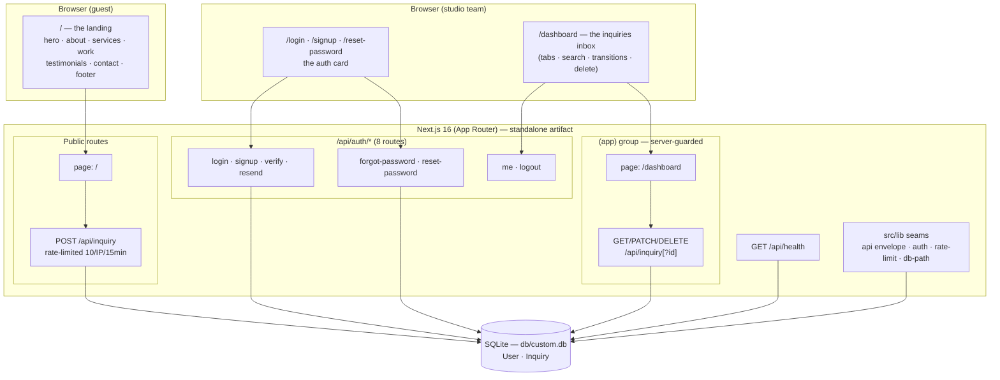

# EleganceFlow — Master Project Architecture Document (PAD) v2.0

**Classification:** Internal Engineering Reference
**Status:** DEFINITIVE, PRODUCTION-LOCKED BLUEPRINT
**Companion Documents:** `README.md` (onboarding) · `AGENTS.md` (agent contract) · `CLAUDE.md` (workflow) · `docs/Tailwind-V4-Validation-Report.md` (styling law)
**Last Updated:** 2026-11-05
**Audience:** Senior Engineers, Tech Leads, DevOps, Onboarding Engineers, and AI Coding Agents
**Rule:** Every architectural decision in this document traces to a specific rationale. Nothing is here "because it's popular."

#### Revision Block — v2.0 (Tracked Changes)

- `[CA]` **The session-199 domain transformation.** The reference re-pointed from the NEO CRM (`neo-crm-8ab2c17c.base44.app`) to **EleganceFlow** (`colossal-elevate-service-flow.base44.app`, a premium creative-studio marketing site). Following the repo's domain-transformation doctrine (the budget-wiser Task-190 precedent): the CRM domain's surfaces retired (16 page families, 11 API route families, ~20 lib modules, the Zustand store, 12 orphan ui primitives, ~90 sweep scripts, 11 dependencies), the infra seams carried verbatim (auth, api envelope, rate-limit, boot-env, db-path, toast), and the app rebuilt byte-mirrored from **nine live Playwright probes** of the new reference. Supersets: persisted inquiries + the authenticated studio inbox at `/dashboard`, the SEO metadata family, the designed 404.

---

## Table of Contents

1. [System Overview & Decisions](#1-system-overview--decisions)
2. [High-Level System Topology](#2-high-level-system-topology)
3. [Application Architecture](#3-application-architecture)
4. [Data Architecture](#4-data-architecture)
5. [Design System Reference](#5-design-system-reference)
6. [Security Architecture](#6-security-architecture)
7. [Testing Strategy](#7-testing-strategy)
8. [Build & Deployment](#8-build--deployment)
9. [Developer Handbook](#9-developer-handbook)
10. [Known Issues & Outstanding Tasks](#10-known-issues--outstanding-tasks)
11. [Key Files Reference](#11-key-files-reference)
12. [Glossary](#12-glossary)

---

## 1. System Overview & Decisions

### 1.1 Document Purpose

This PAD is the single source of truth for the EleganceFlow codebase: what every component is, why every decision was made, and how to extend, debug, or replicate the project. It is written for engineers who will change this code, not for people evaluating it.

### 1.2 Technology Stack Summary

| Layer | Technology | Version | Key Rationale |
| --- | --- | --- | --- |
| Web framework | Next.js (App Router) | ^16.4.2 | Server components guard the authed surface; route handlers serve the API; standalone output is the deployment unit |
| UI runtime | React | ^19.3.1 | The reference's client interactivity class (filters, carousel, form, mobile menu) |
| Language | TypeScript | 5.x (strict) | No `any` in new code; the tsc gate is load-bearing |
| Styling | Tailwind CSS | ^4.3.3 | CSS-first `@theme`; the reference compiles v3-era CSS — every family re-pinned in `globals.css` (see §5) |
| ORM | Prisma | ^6.19.3 | Type-safe queries; `output`-traced schema for the standalone artifact |
| Database | SQLite | via Prisma | Zero-config local story; `db/` at repo root, path-normalized by `src/lib/db-path.ts` |
| Validation | Zod | ^4.6.7 | Every request body parses through one seam (`parseBody`) |
| Auth | node:crypto (scrypt + HMAC) | built-in | Zero auth dependencies; the session + password libs in ~250 lines (routes included, ~830), fully unit-pinned |
| Icons | lucide-react | ^0.525.0 | The reference's exact icon set at its exact sizes |
| Unit tests | Vitest | ^5 | Node env, `@` alias → `src/` |
| E2E tests | Playwright | ^1.64.1 | Boots the standalone artifact; storageState auth; one worker |
| A11y engine | axe-core | ^4.13.0 (devDep) | Injected by the two-gate spec |

### 1.3 Architecture Decision Records

**ADR-001: Next.js App Router with a server-guarded `(app)` route group**

- **Context:** The reference is a base44 SPA: every route serves 200 and its client router walls guests. That posture leaks page HTML to crawlers and lets a client-side guard regress silently.
- **Decision:** Public surfaces (`/`, `/login`, `/signup`, `/reset-password`, the public POST `/api/inquiry`) render without session reads; the workspace (`/dashboard` + the sessioned inquiry family) lives in `src/app/(app)/`, whose `layout.tsx` resolves the session SERVER-side — a guest never receives the inbox's HTML.
- **Rationale:** Fix-over-defect property: the wall can't regress client-side. The guest redirect rides `GuestLoginRedirect` → `/login?from_url=<abs>` (the reference's own round-trip, with the same-origin open-redirect guard).
- **Consequences:** Every inbox route is `force-dynamic` (a session read per request — SQLite local, negligible). 
- **Alternatives rejected:** middleware-based wall (a `headers()` probe carries no path — the from_url round-trip needs it); client-side wall (the reference's own defect).

**ADR-002: The domain transformation (CRM → EleganceFlow)**

- **Context:** The repo's reference re-pointed. The prior 198 sessions built the NEO CRM clone; session-199's audit found a completely different app behind the new URL.
- **Decision:** Retire the CRM domain, carry the infra seams, rebuild the app byte-mirrored from nine live DOM probes. Git history preserves everything retired.
- **Rationale:** The repo's own precedent (budget-wiser Task 190) proved the doctrine; byte-parity requires building from the live reference's DOM, not from memory.
- **Consequences:** The CRM-era tests (~100 files) retired with the domain; the suites rebuilt at 339 unit / 53 e2e, sized to the new codebase. `neo-crm_SKILL.md` stays as the lineage record; `elegance-flow_SKILL.md` carries the new domain.
- **Alternatives rejected:** Keeping CRM pages as dead routes (unmaintained, unpinned, misleading); a second app inside the repo (the doctrine forbids dual-domain trees).

**ADR-003: The inquiry superset (persist, don't just toast)**

- **Context:** The reference's contact form answers a toast and discards the submission (live-verified). A production studio site cannot lose leads.
- **Decision:** The form POSTs `/api/inquiry` — public, Zod-validated through `parseBody`, rate-limited 10/IP/15-min with `Retry-After`, Prisma insert. The success toast is the reference's byte-verified pair. The studio team reads/triages/deletes inquiries at `/dashboard`.
- **Rationale:** The deviation is a strict functional superset, documented at every layer.
- **Consequences:** The status transitions (`new | read | archived`) and the two-step delete are OUR design (the reference has none) — they pass WCAG AA outright and cite no sanctioned matchers.
- **Alternatives rejected:** Toast-only (parity with a defect, not a feature); email delivery (no mail transport in scope; `NEO_DISABLE_IN_APP_OTP`/`_RESET` knobs carry the future mail path).

**ADR-004: Hand-rolled scrypt + HMAC cookie sessions**

- **Context:** Zero-dependency auth, fully unit-pinnable, no opaque provider.
- **Decision:** `src/lib/auth.ts` + `src/lib/password.ts` (node:crypto only): scrypt (N=16384) hashed-at-rest passwords; HMAC-signed `neo_session` cookie embedding `userId` + the row's `tokenVersion`; 7-day fixed expiry (issued at login, no re-issue on read). Email-verification codes stored HASHED; reset tokens stored hashed (SHA-256), consumed atomically (conditional `updateMany`), single-use, 60-min TTL. A password reset bumps `tokenVersion` and evicts every prior cookie.
- **Rationale:** ~160 sessions of production hardening, every seam unit-pinned; no dependency can silently weaken it.
- **Consequences:** No OAuth, no SSO. The Google button on the login card answers an honest "not configured" info toast.
- **Alternatives rejected:** Auth.js (opaque, heavy, untestable at the seam level); JWT (no revocation dimension without a store).

**ADR-005: Tailwind v4 with the v3 palette re-pinned**

- **Context:** The reference compiles v3-era CSS. v4 re-derived its default palette in oklch — every chromatic step diverges visibly (verified against the installed 4.3.3: `zinc-100` v4 oklch(96.7% 0.001 286.375) vs the reference's computed `rgb(244,244,245)`, and so on for every family/step used in `src/`).
- **Decision:** `globals.css` `@theme` re-pins every literal (family, step) pair to the v3 values — zinc (session-199), amber, slate, the s88 family before it — plus `--shadow-sm`, `--blur-sm`, `@custom-variant hover`, and the `leading-*` re-derivations.
- **Rationale:** Parity is computed-face identity; without the re-pins the same class string paints different pixels.
- **Consequences:** New colors must be added to the re-pin block (or verified byte-equal) — the landing battery pins the zinc family.
- **Alternatives rejected:** Tailwind v3 (downgrade); oklch targets (the reference's pixels are the contract).

**ADR-006: Computed-face parity, proven live**

- **Context:** Class-string mirroring is necessary but not sufficient — cascade order differs between the reference's v3 build and our v4 build.
- **Decision:** `scripts/parity-199.ts` boots both apps, extracts ~40 computed-style faces per viewport, and diffs. The one accepted delta: the scrolled header's `bg-zinc-950/95` serializes as `oklab(… /0.95)` (v4 color-mix) vs the reference's `rgba(9,9,11,0.95)` — numerically the same color (`oklabToSrgb(0.140764, 0.00120224, -0.00421676) = (9,9,11)`), the s18 serialization class.
- **Consequences:** The parity script is the acceptance evidence for any styling change to the reference-mirrored surfaces.
- **Alternatives rejected:** Screenshot diffing (fonts/antialiasing noise); manual review (drifts).

---

## 2. High-Level System Topology



Constraints: one Node process (the standalone server); one SQLite file; no external services; the Unsplash imagery and lucide icons are the only third-party fetches (rendering-time).

**The reference's authed world (the round-30 re-census, re-verified rounds 31–32):** the reference's post-login surface is an empty 404 shell family — its demo login succeeds and redirects to `/` (the landing itself), and every candidate authed route (`/dashboard`, `/profile`, `/settings`, `/about`, `/contact`) serves its derived-title "Page Not Found" shell with zero app content; its session rides localStorage (zero cookies). The session-199 record re-verified live 2026-11-06 (the operator's standing login instruction — rounds 30, 31 and 32). Our `/dashboard` inbox is therefore the documented functional superset over an empty reference shell — the parity surface remains the public landing + the auth card family.

**The storage-family record (round-37 — the axis no probe ever read):**
the reference's platform writes localStorage key families per surface
(censused live 2026-11-07, fresh-context probes + the drift `[storage]`
leg): the landing's analytics four (`base44_analytics_session_id` — a
per-session lowercase-alnum id, length 20–22 observed, new per fresh
context, stable across reloads; `base44_app_id` — the constant 24-hex
app id; `base44_from_url`; `base44_functions_version`), the login's own
`i18nextLng` (localStorage is per-origin: a same-context
login-after-landing carries the union), and the post-login seven (+
`token` + `base44_access_token`); sessionStorage stays EMPTY on every
surface, and the session rides client-readable localStorage with ZERO
cookies. OUR app ships the ZERO-KEY posture — zero localStorage AND
zero sessionStorage keys on every surface, guest and authed; the
session rides ONE `httpOnly` cookie (`neo_session` — `document.cookie`
reads empty) — the strictly stronger posture (no client-readable
session state). The platform families are base44 implementation, never
mirrored: storage is not a rendered face (the per-side recorded
divergence class — the body-ink doctrine). The single sanctioned
storage seam in our tree is the error boundary's stale-chunk cooldown
flag (`src/lib/chunk-recovery.ts`), wired through the guarded
`browserSessionStorage()` hand-off (the round-37 F-37a cure — the
prior bare call shipped an inert cooldown). Pinned by
`tests/storage-faces.test.ts` + the drift `[storage]` leg + the e2e
zero-storage legs; re-verified live 2026-11-07 (the operator's standing
login instruction round: the authed-world census re-taken — the
seven-key family re-recorded).

**The network-family record (round-38 — the request axis no probe ever
read):** the reference's platform fires a FOUR-REQUEST API family on
every landing load (censused live 2026-11-07, fresh-context probes +
the drift `[network]` leg): `GET /api/apps/<24-hex>/entities/User/me`
→ 401 guest (the logged-out session check), `POST
/api/app-logs/<app-id>/log-user-in-app/home` → 200 with NO body (the
app-log beacon), `GET /api/apps/public/prod/public-settings/by-id/
<app-id>` → 200 (the platform config fetch), and `POST
/api/apps/<app-id>/analytics/track/batch` → 200 (~189B, one event per
load; the event's SHAPE — keys only, never values: `event_name`,
`properties{referrer}`, `timestamp`, `page_url`, `user_id: null`
guest, `session_id` — the storage round's 18–24 lowercase-alnum
window). OUR app fires ZERO api-like requests on load — the document
alone; every `fetch()` in `src/` is user-initiated (the contact-form
POST, the auth forms, the dashboard ops, the logout), and the beacon
families (`navigator.sendBeacon`, `XMLHttpRequest`, absolute-URL
fetch) are absent from the tree — the strictly cleaner posture (no
load-time platform chatter; the session rides the httpOnly cookie
server-side). The platform's network family is base44 implementation,
never mirrored: the network is not a rendered face. The
response-header face: the session-20 three-header security set ships
IDENTICAL on both apps' documents; the artifact ships NO `X-Powered-By`
(the round-38 F-38a cure — `poweredByHeader: false`; the scaffold
default had disclosed `X-Powered-By: Next.js` on every server-rendered
HTML face through 37 rounds while the reference discloses none); the
per-side infra families (the reference's cloudflare/Caddy/uvicorn edge
headers, OURS the x-nextjs cache diagnostics) are implementation
plumbing, recorded per side, never mirrored. Pinned by
`tests/network-faces.test.ts` + `tests/http-headers.test.ts` (the
config pin) + the drift `[network]` leg + the e2e zero-disclosure
legs.

**The beacon-payload value record (round-40 — the semantics the
round-38 shape census left unread):** the analytics batch's payload
VALUES decoded live 2026-11-08 (fresh-context probes + the extended
drift `[network]` leg): the platform's only event is the CONSTANT
`__initialization_event__` (the same name guest and authed); the
timestamp rides the ISO-8601 UTC-with-milliseconds shape
(`2026-11-07T23:34:04.396Z`); the page_url is the PATH ONLY (`/`,
never absolute); the user_id is `null` on the guest load and the
24-hex user id after the demo login (the authed-world beacon family);
the properties.referrer is `""` on a direct load and the ABSOLUTE
login URL on the post-login landing load; the session_id is the
lowercase-alnum per-session id (the recorded 18–24 window), STABLE
across the login — and LINKED to the storage family's
`base44_analytics_session_id` (two views of ONE per-session id; the
storage and network legs now cross-check the linkage). The
INTERACTIVE axis (the batch question answered): interaction fires
ZERO api-like requests — the CTA click, the nav-link click, the
portfolio-filter click, and the mobile-menu ride each fire nothing;
the load-time four-request family is the COMPLETE family
(`events:array(1)` is the per-load constant, never a batching
artifact). OUR runtime twin: the round-40 e2e legs pin the ARTIFACT's
on-the-wire zero-request family (the document alone on load + the
interactive zero) — the runtime twin of the source census, closing
the dependency-planted-beacon class (a beacon living in node_modules
evades the src-only needles; the wire closes it). Pinned by the
round-40 blocks of `tests/network-faces.test.ts` + the e2e round-40
describe + the drift `[network]` leg's `beaconSemantics` /
`sessionLinkage` / `interactiveFamily` constants.

**The response-body record (round-41 — the response side the request
censuses never read):** the platform's answers to its four-request
landing family decoded live 2026-11-08 (fresh-context probes, twice,
constants byte-stable + the extended drift `[network]` leg): the
guest family is 3×200 + a DESIGNED 401 — `public-settings` answers
`{"id":"<24-hex>","public_settings":"public_without_login"}` (the
app's access-policy CONSTANT), the app-log beacon answers
`{"success":true}` and the analytics batch answers `{"accepted":1}`
(the receipt constants, mirroring the request's `events:array(1)`),
and the guest `User/me` session check answers **401** with the
platform's auth-required error envelope (the 5-key
`message`/`detail`/`traceback`/`extra_data`/`request_id` shape — the
DESIGNED failing session check, the platform's own face on every
guest load). The login-surface family (the same round's live decode):
the domain→app-id resolution (`GET /api/apps/public/prod/domain/
<host>` → 200, the bare quoted hex24) and the login-info record
(`GET /api/apps/public/login-info/by-id/<24-hex>` → 200 — id, name
"EleganceFlow", slug, logo_url, user_description byte-identical to
SITE_DESCRIPTION, created/updated dates, and the `auth_config`
object: `enable_username_password: true`, `enable_google_login:
true`, `mfa_policy: "off"` — the record that DRIVES the reference's
login card, its provider set riding the platform's own auth_config);
the authed family adds the `User/me` SUCCESS record (role, id, email,
`is_verified: true`, app_id, `_app_role`) and the platform
frontend-config script (`/api/frontend-config.js?v=3` —
`window.__APP_CONFIG__`, the platform's BACKEND_URL/TURNSTILE/
GOOGLE_CLIENT_ID plumbing, application/javascript). OUR runtime
twin: the round-41 e2e leg pins the ARTIFACT's on-the-wire
zero-RESPONSE family (the response-event twin of the round-40
request legs — a service-worker-served or prefetched api-like
response arrives without a page-initiated request event). Pinned by
the round-41 blocks of `tests/network-faces.test.ts` + the e2e
round-41 describe + the drift `[network]` leg's `responseSemantics`
constants.

**The combination-matrix record (round-39 — the media-axis combinations
no probe ever read):** rounds 29/31/32 censused the three emulateMedia
axes INDIVIDUALLY (reduce · forcedColors · colorScheme); the pairwise
`forced+scheme-dark` and the full triple stack were never read until
round-39 (censused live 2026-11-08, fresh-context probes + the drift
`[stack]` leg, the 24th). Every shared computed face is IDENTICAL both
apps under every stack: the forced palette COMPOSES with the emulated
scheme (the dark system palette — body canvas opaque black, the h1
CanvasText white, the CTA LinkText `rgb(255, 255, 0)`, the featured
card the dark Canvas), and the html `color-scheme` face reads `light
dark` under forcedColors (the UA's forced reporting — `normal` at
screen; a fresh constant both apps). The recorded per-side constants
COMPOSE additively: the round-29 reduce collapse (OURS 0.01ms vs the
reference's 0.3s/0.5s full-duration animation) survives the forced
palette — **the a11y superset composes**, never beaten by the system
palette; the body-ink dead face survives the non-forced stacks. The
axe-under-combination families (the round-33 F-33b artifact class
extended): under `forced+scheme-dark` axe's color-contrast citations
EXPLODE beyond every recorded per-axis constant — the login's 11 nodes
(the h1, the subtitle, the Google span, the divider, both labels, both
inputs, both bottom buttons + the Sign up span) BYTE-IDENTICAL on both
apps (the reference's own face), the landing's 16 (the at-screen count
with the eyebrow→hero swap), and OUR dashboard's 22 (the superset's
own surface). The MECHANISM: text computes CanvasText WHITE while
backgrounds serialize `rgba(0, 0, 0, 0)` / `rgba(0, 0, 0, 0.5/0.7)` —
axe cannot resolve the backdrop and flags the pair; the RENDER is
pixel-verified legible (white glyphs on the black canvas,
CanvasText-on-Canvas 21:1) — the flags are the axe math artifact,
never a painted divergence. The per-axis decomposition (live, /login):
default ZERO · reduce only ZERO · scheme-dark only ZERO · forced only
(light) ZERO · forced+scheme-dark 11 — the finding is
COMBINATION-ONLY. Pinned by `tests/stack-faces.test.ts` + the round-39
e2e describe in `tests/e2e/a11y.spec.ts` (the census-baseline counts —
a moved count REDs the pin and forces a conscious re-record) + the
drift `[stack]` leg.

---

## 3. Application Architecture

### 3.1 The Layer Model

```
Layer 0: prisma/schema.prisma — the data model (User, Inquiry).
         Rule: the Prisma client is the only DB access; every consumer imports src/lib/db.
Layer 1: src/lib — the seams, 18 modules (api, auth, password, rate-limit,
         schemas, db, db-path, site, site-content, page-layout, login-reset,
         verification, verification-server, boot-env, chunk-recovery, utils,
         route-title, reveal).
         Rule: pure, unit-testable, no React. Routes compose seams; they never inline seam logic.
Layer 2: src/app/api — route handlers. Rule: envelope in/out (ok/fail), parseBody
         for every body, requireSession for every sessioned route, try/catch → ERR.INTERNAL.
Layer 3: src/components — presentation. Rule: content strings come from
         src/lib/site-content.ts; class strings are the reference's own (byte-mirrored).
Layer 4: src/app pages — thin routes composing Layer 3; metadata via
         src/lib/site.ts's pageMetadata() factory; the (app) group guards server-side.
```

The Golden Rule: **a class string on a reference-mirrored surface is evidence-backed or it doesn't ship** — every pin cites its probe.

### 3.2 Annotated Directory Structure

```
elegance-flow/
├── prisma/
│   ├── schema.prisma          # User (auth surface) + Inquiry (the superset's model)
│   └── seed.ts                # idempotent: 3 inquiries (one per status) + 4 users, upsert-by-email
├── db/                        # gitignored; custom.db (dev) · e2e.db · smoke.db
├── src/
│   ├── app/
│   │   ├── layout.tsx         # root layout: metadataBase + OG family + Toaster
│   │   ├── page.tsx           # the public landing (renders LandingPage)
│   │   ├── globals.css        # @theme tokens — THE v3 re-pins (§5)
│   │   ├── not-found.tsx · not-found-body.tsx   # the designed 404 (true 404 status; our superset)
│   │   ├── error.tsx · global-error.tsx  # error boundaries (chunk-recovery ride)
│   │   ├── login/ · signup/ · reset-password/   # the auth routes (login/signup: the login card · reset: the platform family)
│   │   ├── (app)/
│   │   │   ├── layout.tsx     # the server guard: getSessionUser → AppShell | GuestLoginRedirect
│   │   │   └── dashboard/
│   │   │       ├── page.tsx   # server route: metadata + InboxPage
│   │   │       └── inbox-page.tsx  # the client inbox
│   │   ├── api/
│   │   │   ├── auth/           # login · signup · verify · resend · forgot-password
│   │   │   │                   # reset-password · me · logout (8 handlers)
│   │   │   ├── inquiry/        # POST (public) + GET (sessioned list)
│   │   │   ├── inquiry/[id]/   # PATCH (status) + DELETE (sessioned)
│   │   │   ├── health/         # GET: db round-trip; 503 when down
│   │   │   ├── robots.txt/ · sitemap.xml/ · manifest.json/   # the SEO family
│   │   ├── icon.png · apple-icon.png      # the file-convention icons
│   │   └── vendor/tw-animate.css          # the tw-animate utilities (the toast's enter/exit classes)
│   ├── components/
│   │   ├── landing/landing-page.tsx     # THE reference mirror (the one-pager)
│   │   ├── layout/
│   │   │   ├── login-card.tsx           # the auth card (5 in-place views)
│   │   │   ├── reset-password-screen.tsx# the reset form (token-aware)
│   │   │   ├── app-shell.tsx            # the authed chrome (topbar + main + footer)
│   │   │   └── guest-login-redirect.tsx # the from_url wall shim
│   │   └── ui/toast.tsx                # the toast system (module-level store)
│   ├── lib/                    # see §3.1 Layer 1
│   ├── types/index.ts          # User · Inquiry wire shapes · Result
│   └── instrumentation.ts     # the boot gate (boot-env)
├── tests/                     # 58 *.test.ts + e2e/ (8 specs + setups)
├── scripts/                   # census · smoke ladder · parity probe · captures · probes
├── docs/                      # plans · screenshots · Tailwind report · skills
├── skills/                    # the catalog + 100+ skills (agent tooling)
├── AGENTS.md · CLAUDE.md · README.md · worklog.md · this PAD
└── next.config.ts · tsconfig.json · eslint.config.mjs · vitest.config.ts · playwright.config.ts
```

### 3.3 Critical Code Patterns

**Pattern 1 — The parseBody seam (every body, one door)**

```ts
// src/app/api/inquiry/route.ts (POST) — the canonical route shape
export async function POST(req: Request) {
  // The auth family's canonical order: the limiter, then the composed
  // parse seam (the declared-size pre-gate rides INSIDE parseBody).
  const limit = rateLimit(`inquiry:${clientKey(req)}`, INQUIRY_RATE_LIMIT, INQUIRY_RATE_WINDOW_MS);
  if (!limit.allowed) return ERR.RATE_LIMITED(limit.retryAfterSec);

  const parsed = await parseBody(req, inquiryCreateSchema);
  if (!parsed.ok) return parsed.response;   // the Zod seam's own 400s
  const body = parsed.data;

  try {
    const inquiry = await db.inquiry.create({ data: { ...body, status: "new" } });
    return ok({ id: inquiry.id }, 201);
  } catch {
    return ERR.INTERNAL();                   // DB failures stay inside the envelope
  }
}
```

*Why this pattern:* `parseBody` composes the content-type CSRF gate, the declared-length 16KB pre-gate, and the schema — one call, unit-gated, no bare `req.json()` anywhere in `src/app/api` (the body-pregate suite sweeps every route file).

**Pattern 2 — The content seam (site-content is the ONE source)**

```ts
// src/lib/site-content.ts — the DOM-case discipline
export const HERO = {
  eyebrow: "Premium Services",              // DOM text; "PREMIUM SERVICES" rides CSS uppercase
  headingLines: ["Work that speaks", "for itself."],  // the reference's h1 spans
  primaryCta: "Start a Project",
  ...
} as const;

// src/components/landing/landing-page.tsx — pure presentation
<h1 className="text-5xl md:text-7xl lg:text-8xl font-black text-white tracking-tight mb-8">
  <span className="block">{HERO.headingLines[0]}</span>
  <span className="block">{HERO.headingLines[1]}</span>
</h1>
```

*Why:* e2e locators and unit pins assert against DOM-case strings; the component layer never hand-spells content. `tests/site-content.test.ts` pins every string against the probe record.

**Pattern 3 — The computed-face re-derivation (the s11 doctrine)**

```tsx
{/* The reference's class list carries leading-[0.9], but its OWN build never
    applies it at md+ (its text-Nxl line-height:1 rules sort later). Our v4
    sorts the arbitrary leading LAST at every width — so the port is
    leading-[0.9] md:leading-none: 0.9 below md, 1 from md up. */}
<h1 className="... leading-[0.9] md:leading-none tracking-tight mb-8">
```

*Why:* parity is the COMPUTED face, not the literal class. Copying a class that renders differently than it reads is the one thing the doctrine forbids — and the parity probe would catch it anyway (86.4px vs 96px line-heights).

**Pattern 4 — The two-step delete (destructive actions never ride one click)**

```tsx
{confirmId === row.id ? (
  <>
    <button data-testid="confirm-delete" onClick={() => void remove(row)}>Confirm delete</button>
    <button onClick={() => setConfirmId(null)}>Cancel</button>
  </>
) : (
  <button data-testid="delete" aria-label={`Delete inquiry from ${row.name}`}
          onClick={() => setConfirmId(row.id)}>
    <Trash2 size={14} />
  </button>
)}
```

*Why:* the inbox is OUR surface — there is no reference face to mirror, so the production-grade pattern ships with its own pins (`tests/auth-surfaces.test.ts` + the e2e battery).

---

## 4. Data Architecture

### 4.1 Schema

```prisma
model User {
  id            String   @id @default(cuid())
  email         String   @unique            // normalized lowercase at the Zod seam
  name          String
  passwordHash  String                      // scrypt, auth.ts's format
  avatarColor   String   @default("#2563eb")
  photoUrl      String?
  role          String   @default("user")
  verificationCodeHash  String?             // 6-digit OTP hashed at rest
  verificationAttempts  Int       @default(0)
  verificationExpiresAt DateTime?
  tokenVersion  Int      @default(0)        // the revocation dimension
  resetToken            String?             // SHA-256 hex of the raw token
  resetTokenExpiresAt   DateTime?
  createdAt DateTime @default(now())
  updatedAt DateTime @updatedAt
}

model Inquiry {
  id        String   @id @default(cuid())
  name      String                      // ≤ 120 chars (Zod)
  email     String                      // normalized lowercase, RFC-ish regex
  service   String                      // the form-select vocabulary (5 options)
  message   String                      // ≤ 2000 chars
  status    String   @default("new")    // new | read | archived
  createdAt DateTime @default(now())
  updatedAt DateTime @updatedAt
  @@index([status]) @@index([createdAt])
}
```

### 4.2 Persistence Strategy

- **Path resolution:** `src/lib/db-path.ts` normalizes `file:` URLs to `<repo>/db/<name>` for BOTH the Prisma CLI (relative to `prisma/schema.prisma`) and the running server (CWD-independent). `bun run db:census` prints the resolved path + counts and fails on drift.
- **Migrations:** `db push` (no migration journal — the dev-story contract); the schema is the source of truth.
- **Idempotent seed:** `deleteMany` the domain table, upsert users by email (ids stay stable across re-seeds — session cookies survive).
- **Scratch databases:** `db/e2e.db` (playwright global-setup pushes + seeds per run), `db/smoke.db` (the smoke ladder) — all gitignored.
- **The atomic transitions:** the PATCH status move and the DELETE both ride `updateMany`/`deleteMany` + count — a missing row answers 404, a racing replay can never resurrect.

---

## 5. Design System Reference

### 5.1 Typography

The reference ships **zero webfonts** — the stack is pinned in `@theme` (`--font-sans: ui-sans-serif, system-ui, sans-serif, "Apple Color Emoji", …`). Display headings: `font-black`, `tracking-tight`, two-block-span constructions; body: `text-sm/base/lg` system sizes. The landing ships sharp corners (radius 0) everywhere; the login/signup card carries `rounded-2xl` + slate, while /reset-password carries the base44 platform's OWN reset family (`rounded-lg` + gray — the round-26 platform-auth census; the reference's own two design systems).

### 5.2 Color Tokens (the re-pin family)

| Role | Token / class | Hex (v3 re-pin) | Notes |
| --- | --- | --- | --- |
| Dark sections | `bg-zinc-950` | #09090b | rgb(9,9,11) — computed-verified on the reference |
| Service cards | `bg-zinc-900` | #18181b | with `border-white/5`, hover `border-white/20` |
| Micro-labels | `text-zinc-400` | #a1a1aa | the reference's form-label ink (sanctioned at 2.56:1) |
| Body on white | `text-zinc-500` | #71717a | |
| Filter chip inactive | `bg-zinc-100 text-zinc-500` | #f4f4f5 / #71717a | 4.39:1 (axe) — sanctioned (the reference's own face) |
| Accent | `bg-amber-500 text-black` | #f59e0b | every CTA, every eyebrow, the accent bar, the active chip |
| Featured card | `bg-amber-500` + `text-zinc-950`, body `text-zinc-900/70` | — | the Design & Web card (probe-verified) |
| Auth card | slate family (re-pinned) + `bg-white/95 backdrop-blur-sm` | — | `--blur-sm: 4px` re-pin |

**The body-ink dead-face record (round-30, the single-token compromise):** the BODY element's own computed `color` is the one face the round-13 `--color-foreground: #09090b` re-pin could not match — the reference's TWO bundles disagree on it. Its LANDING bundle ships `body { color: hsl(var(--foreground)) }` with the stock shadcn `0 0% 3.9%` (neutral-950 → **rgb(10, 10, 10)**) while its PLATFORM bundle (the auth card — the drift login leg's evidence) computes zinc-950. The single token took the LIVE face (the auth card's rgb(9, 9, 11)); our body therefore computes **rgb(9, 9, 11)** vs the reference's rgb(10, 10, 10) — a recorded dead-face divergence in the s18 serialization class's pattern: numerically different, paint-equivalent, because ZERO text nodes ride the body default on either app (every visible text carries explicit ink — the h2s own `text-zinc-950`, the services card div carries it, the select owns it, the dark sections carry white/zinc inks; pinned by `tests/body-ink-faces.test.ts`, re-probed live by the drift `[body-ink]` leg). The same round's print-media census: both apps ship zero `@media print` rules and compute identical faces under print emulation (the white-on-white hazard of the dark sections is the reference's own zero-handling posture — recorded per-side, never mirrored).

**The forced-colors census record (round-31 — the positive census, the media-axis set completed):** under `forcedColors: "active"` (Chromium's Windows-high-contrast emulation) both apps compute IDENTICAL faces on every probed element — the landing family (html/body, the hero h1 → CanvasText black **rgb(0, 0, 0)**, the header, the amber CTA → the system LinkText **rgb(0, 0, 159)**, the featured card → Canvas white **rgb(255, 255, 255)**, the non-featured cards, the services h2, the contact input/select, the footer) and the login auth-card family (the inputs keep the reference's own `rgba(255, 255, 255, 0.5)` translucency, identical both sides). Both apps ship ZERO `@media (forced-colors)` rules and no `forced-color-adjust` override (`auto` everywhere) — the reference's own zero-handling posture is the byte-mirror default we ship; the browser renders both apps identically legible, so no WCAG forced-colors criterion rides the a11y two-gate baseline (the print posture, not the reduce posture). The census walks `CSSMediaRule` objects, never substrings — our rendered bundle's `@layer utilities` block contains the STRING "forced-colors" (Tailwind v4's `forced-color-adjust-*` utility class definitions, generated at build), which a substring census would miscount as a rule (the round-30 `.test(` census-collision genus: the counting rule must match the thing counted). The featured-card class-literal note rides the s11 doctrine: the reference's card div carries no `bg-amber-500` class yet computes the amber face (its bundle's own mechanism); ours spells the class — the computed faces identical at screen and under the collapse. The same round's form-control theme census: `accent-color: auto` + `color-scheme: normal` on both apps (neither declares either), the login email caret zinc-950. Pinned by `tests/forced-colors-faces.test.ts`, re-probed live by the drift `[forced-colors]` leg (the 19th). With round-29 (reduce), round-30 (print) and round-31 (forced-colors), every media axis Playwright's `emulateMedia` surface exposes is censused.

**The color-scheme census record (round-32 — the positive census, the emulateMedia surface completed):** under `colorScheme: "dark"` AND `"light"` emulation both apps compute IDENTICAL faces and NOTHING MOVES — html `color-scheme: normal` both apps both schemes (neither declares the property), body bg white, the h1 white ink, the header transparent, the footer zinc-950, the login email's translucent slate-50 fill — the same values under dark, light and default emulation on each app. Neither app ships a `prefers-color-scheme` media rule (the CSSMediaRule walk: zero both sides). The reference ships no dark-mode face; ours mirrors the zero-handling posture (the byte-mirror default — the print/forced-colors posture). The recorded per-side constants are scheme-invariant: the body-ink dead face (REF `rgb(10, 10, 10)` vs OURS `rgb(9, 9, 11)`, the round-30 compromise) and the login email's s18 serialization pair (REF `rgba(248, 250, 252, 0.5)` vs OURS `oklab(…/0.5)`) read the same under every emulation. The same round's superset forced-colors a11y sweep: axe-core under `forcedColors: "active"` on `/dashboard` returns ZERO violations (structural and contrast clean — the superset's own surface stays legible under the system-palette collapse). Pinned by `tests/color-scheme-faces.test.ts`, re-probed live by the drift `[color-scheme]` leg (the 20th). With round-29 (reduce), round-30 (print), round-31 (forced-colors) and round-32 (colorScheme), every axis of Playwright's `emulateMedia` surface rides a census leg.

**The forced-colors landing-register census record (round-33 — the session-58 candidate 1, a positive census):** under `forcedColors: "active"` the landing's axe-core color-contrast citations COLLAPSE from the 16 sanctioned screen nodes to exactly 3 — the amber-500 EYEBROW family (the hero, services and testimonials section headers, the zinc-950-section eyebrows; the below-fold content is reveal-hidden at rest, so the mount-visible headers are what the sweep sees). The mechanism: under the collapse every eyebrow computes CanvasText rgb(0,0,0) ink over Chromium's forced-colors background serialization, which axe cannot resolve to a solid backdrop — the flag is the browser-emulation artifact, NOT a painted divergence. The REFERENCE's own sweep under the same condition flags the SAME three elements (its eyebrows carry no `text-amber-500` class — the F-31c class-literal decode again) plus one `select-name` violation (its unassociated contact select — OURS binds id/htmlFor, the standing a11y superset). The register's existing amber-eyebrow arm covers the collapsed face; pinned by the e2e census leg in `tests/e2e/a11y.spec.ts` (structural zero + the three-node shape). The same round's tooling cure: the four live probe scripts navigate through `scripts/probe-load.ts` (the HMR-tolerant load — a bare `waitUntil: "networkidle"` goto never settles against the dev server's Turbopack HMR websockets; pinned by `tests/probe-load-contract.test.ts`).

**The stacked-emulation census record (round-34 — the session-60 candidate 1, a positive census):** under `reducedMotion: "reduce"` AND `forcedColors: "active"` STACKED (no leg ever stacked two emulateMedia axes) both apps compute IDENTICAL faces — the collapsed family (html/body/hero h1/header/footer all CanvasText rgb(0,0,0) ink, Canvas surfaces, html `scroll-behavior: smooth` both apps) and the reveal family settles to the post-reveal end state (opacity 1 / transform none) with the per-side reduce constant unchanged (OURS `transition-duration 1e-05s` — the round-29 collapse superset — vs REF `0s`, its zero-handling face; the divergence rides the recorded drift `[motion-prefs]` constants). The two axes are orthogonal: the forced-colors collapse paints, the reduce collapse animates, neither perturbs the other's face. Pinned by the e2e census leg in `tests/e2e/landing.spec.ts` (the collapsed faces + the reveal snap-settle + the html smooth face unchanged + the restore round-trip).

**The route-transition scroll cure record (round-34 — F-34a, a functional cure):** the `<html>` element carries `data-scroll-behavior="smooth"` (layout.tsx) — the Next.js 16 contract the reference cannot teach (it is a base44 SPA with no Next router): the App Router wraps every route-transition scroll in `disableSmoothScrollDuringRouteTransition`, which reads `dataset.scrollBehavior === 'smooth'`; without the attribute the router's scroll-to-top rides the CSS smooth rule (live-proven against `bun run dev`: the post-login transition `/login` scrolled 300px → `router.push('/dashboard')` animated 300→188→163→121→115 across ~500ms — 47 intermediate samples — instead of the instant reset; the dev server warns on every load). With the attribute the router temporarily sets `scroll-behavior: auto` around its transition scrolls and restores it after; hash-only changes keep the smooth ride (the landing's anchor navigation — the parity face — untouched). The attribute is INVISIBLE to every computed-face probe (a data attribute changes no CSS): parity, drift, the mobile census and the captures are all unaffected — the a11y-superset doctrine's next member (the `aria-expanded` pattern). Pinned by `tests/scroll-behavior-attr.test.ts` (the attribute + the globals smooth rule + the two e2e legs' source contracts) + the instant-scroll e2e leg (the logout ride's zero-intermediate contract, `tests/e2e/dashboard-inbox.spec.ts`).

**The orientation-family census record (round-35 — the session-56 candidate 2 closed, a positive census):** the phone held in LANDSCAPE (844×390, the md boundary crossed from below) — the one viewport configuration no permanent probe ever censused — computes IDENTICAL faces on both apps across the whole family: the closed-state header flip (the hamburger and the inline panel retire on their `md:hidden` classes, the desktop nav and the amber CTA render, the h1 rides its md step), the auth card's landscape geometry (the `max-w-md` card at x=198 — the exact (844−448)/2 centering — width 448, the short-height scrollability), and the print-landscape faces (h1 white, body bg white, html ink black, ZERO `@media print` rules both sides — the round-30 zero-handling posture at the orientation axis). The ROTATION ride (the operator's standing emphasis at the orientation crossing): an OPEN mobile menu crossing to landscape hides both `md:hidden` faces while the open-state SURVIVES hidden (the label stays "Close menu"), and rotating back REOPENS the panel automatically — the reference's own face, live-proven identical (the sole delta OUR aria-expanded, the documented superset). The a11y register at landscape: the landing's axe sweep flags the SAME 16 sanctioned contrast nodes on both apps (the register that rides 1280/390-portrait holds at the orientation) plus the reference's own select-name gap (OURS binds id/htmlFor); the superset's `/dashboard` renders sanely at 844×390 with ZERO axe violations. Neither app ships an orientation directive (no lock, no landscape meta) — the landscape face is purely WIDTH-DRIVEN. Pinned by `tests/orientation-faces.test.ts` (the md:hidden pair + the no-directive posture + the three e2e legs' source contracts) + the rotation leg (`tests/e2e/mobile-navigation.spec.ts`) + the landscape print leg (`tests/e2e/landing.spec.ts`) + the landscape login leg (`tests/e2e/auth.spec.ts`); re-probed live by the drift `[orientation]` leg (the 21st).

**The probe-stability guard record (round-36 — F-36a, a tooling cure):** the dev server's COLD-BOOT FAST-REFRESH RELOAD LOOP — diagnosed live while executing the standing probe battery in a fresh sandbox. After a gate's `next build` wipes `.next/dev`, the FIRST `bun run dev` boot can (intermittently — not reproduced on a controlled rebuild+boot) enter an infinite full-page-reload loop: every HMR connect announces `[Fast Refresh] rebuilding` (the console signature `[HMR] connected` + `[Fast Refresh] rebuilding` at sub-second cadence; 126 main-frame navigations observed on ONE idle load, 549 `GET /` requests in dev.log). Every live probe then wedges or lies — in-flight evaluates throw `Execution context was destroyed`, clicks land on UN-HYDRATED pages (the mobile-menu toggle reads `aria-expanded` false after a click — the operator's standing emphasis's exact false-negative). The empirical cure (live-proven): RESTART the dev server — the second boot reads the warmed `.next/dev` state and is stable. The shipped guard: `probeLoad` counts main-frame navigations across its settle window — a stray post-connect reload (the dev server's normal on-demand-compile face) settles inside ONE confirming extension window (1_500) and the load proceeds; a SUSTAINED loop keeps firing through the extension and throws the DIAGNOSED error (the restart cure named in the message — loud seconds instead of a silent minutes-long wedge), proven live against a synthetic looping page (the throw fires) and a synthetic stray-reload page (the pass fires). The companion budget record (F-36b): the drift probe takes ~6.5 minutes end-to-end (measured under bun AND node) — never wrap it in a sub-10-minute timeout (the kill cascade fakes a browser crash at a deep leg: `Target page, context or browser has been closed` at whichever leg was in flight, bun hanging after the kill — a healthy script misdiagnosed as broken). Pinned by the round-36 blocks of `tests/probe-load-contract.test.ts` (the counter's listener + mainFrame filter + the post-goto attach order + the finally detach + the confirming extension + the diagnosed message + the AGENTS.md/drift-header doc pins), mutation-proven 4/4 classes bite.

**The WCAG 2.2 AA posture:** structural violations zero everywhere; every interactive control on the superset's own surfaces renders a VISIBLE focus ring (the round-10 focus-visible family — the inbox tabs/action buttons and the shell's controls ride `focus-visible:ring-*`; the keyboard-operability e2e battery pins the rides and the computed faces); color-contrast nodes on reference-mirrored surfaces must cite the sanctioned register in `tests/e2e/a11y.spec.ts` (each matcher names its probe-verified citation); the superset's own surfaces (inbox, shell) carry no matchers — they pass outright (amber-700 inks, zinc-600/500 muted text, white/50 footer).

### 5.3 Component Primitives

No UI framework beyond Tailwind: the landing is hand-built reference markup; `ui/toast.tsx` is the only shared primitive (a module-level store + viewport, mirroring the reference's toast viewport classes). The 12 shadcn-era primitives retired with their CRM consumers.

### 5.4 Motion

The reference ships a twenty-element scroll-reveal/mount-cascade family — REPRODUCED since round-28 as the `REVEAL_FAMILY` seam (`src/lib/reveal.ts`) + the `useRevealGroup` wiring (one-shot IntersectionObservers, the live-probed offsets/staggers, the ~800ms ease-out decode; the drift [reveal] leg re-proves it live every run). The globals' `prefers-reduced-motion` block and `@custom-variant hover` un-wrap (touch hovers fire) are the standing motion contracts; the transition classes on the landing are the reference's own (`transition-all duration-500` header, `duration-700` image scales).

**The reduced-motion superset (round-29, the recorded divergence):** under `prefers-reduced-motion: reduce` the reference ships ZERO handling — its raf-driven reveal still animates the full progression and its CSS transitions (services `0.3s`, header `0.5s`) run at full duration — while OURS collapses every CSS transition to `0.01ms` (computed `1e-05s`, beating the reveal family's inline durations by the cascade: author `!important` > inline normal) so the reveal family snaps without a mid-flight window. The at-rest hidden family, the settled hero/mount family and the post-reveal end state are IDENTICAL under reduce; the block kills durations but never `transition-delay`, so the cascade's staggered snaps still space at 0/100/200/600ms and content never sticks hidden. The block is a deliberate a11y superset (the `scroll-behavior: smooth` precedent — a visible functional superset, documented and pinned by `tests/reduced-motion-faces.test.ts` + the drift [motion-prefs] leg's per-side constants); the reference's own gap is recorded per-side, never mirrored.

---

## 6. Security Architecture

### 6.1 Security Rules

| Rule | Enforcement |
| --- | --- |
| Every body-parsing route validates size (16KB), content-type (JSON-only), shape (Zod) | `parseBody` seam — unit-gated (body-pregate suite sweeps `src/app/api/**`) |
| Every sessioned route resolves the session server-side | `requireSession()` — the (app) layout guard + every sessioned handler |
| Every public mutating route is rate-limited per IP | `rateLimit` fixed windows; 429 carries `Retry-After` (pinned) |
| Every route answers the envelope | `ok`/`fail`/`ERR.*`; DB writes wrapped → `ERR.INTERNAL()` |
| No user enumeration | signup duplicate 409 vs. forgot-password 200 for known AND unknown emails |
| No open redirect | `resolveFromUrl` same-origin check on `from_url` |
| Secrets never in the tree | `.env` gitignored-by-convention; boot gate fail-fasts a missing `AUTH_SECRET` in production |
| No keys/shims committed | the ssh wrapper reads keys from OUTSIDE the repo (tempfile 0600, shredded after) |

### 6.2 Security Utilities

- `src/lib/password.ts` — scrypt (N=16384, 16B salt) hash/verify + the timing equalizer.
- `src/lib/auth.ts` — HMAC-SHA256 cookie sessions, hashed-at-rest OTP + reset tokens, tokenVersion compare, atomic reset consumption.
- `src/lib/rate-limit.ts` — per-process fixed windows with `clientKey` (XFF last-hop trust via `NEO_PROXY_HOPS`, fail-closed to 1).
- `src/lib/api.ts` — `parseBody` (content-type gate → declared-length fast path → stream counter → Zod), `ERR` family.
- `src/lib/boot-env.ts` — the production boot gate (refuses to serve without a real `AUTH_SECRET`; the log names the fix).

### 6.3 Auth Flows

1. **Login:** rate-limit → Zod → timing-equalized verify → verification-pending 403 → cookie mint (id + tokenVersion).
2. **Signup:** rate-limit → Zod → uniqueness → hashed OTP → (in-app code delivery behind `NEO_DISABLE_IN_APP_OTP`).
3. **Verify:** attempt ladder (5-wrong lockout, atomic increments) → session mint on success.
4. **Forgot/reset:** no-enumeration 200 → hashed single-use 60-min token → conditional atomic consume → `tokenVersion++` (all prior cookies die) → new session.

### 6.4 Threat Model (key vectors)

| Vector | Mitigation |
| --- | --- |
| Password stuffing | 10/IP/15-min + scrypt cost + the timing equalizer (registered-email probing) |
| CSRF on state-changing routes | JSON-only content-type gate (the `enctype="text/plain"` form family) + same-site=lax cookies |
| Oversized bodies | 16KB declared pre-gate + streamed counter (before any parse) |
| Stolen session persistence | tokenVersion revocation on reset; 7-day expiry |
| Reset token replay | conditional atomic consume + 60-min TTL + hashed at rest |
| Open redirect via `from_url` | same-origin resolution, `/dashboard` fallback |

---

## 7. Testing Strategy

### 7.1 Distribution

| Category | Files | Checks | Location | Framework |
| --- | --- | --- | --- | --- |
| Unit — seam batteries | 13 | 199 | `tests/*.test.ts` | Vitest (node, imports the seams) |
| Unit — source contracts | 45 | 458 | `tests/*.test.ts` | Vitest (module contracts + comment-stripped reads) |
| E2E | 8 specs | 136 | `tests/e2e/*.spec.ts` | Playwright (standalone artifact, 1 worker) |
| Smoke | 1 ladder | 14 rungs | `scripts/smoke-test.sh` | curl + the artifact on :3210 |
| Live parity | 1 probe | ~80 faces | `scripts/parity-199.ts` | Playwright (both apps) |
| A11y | 9 scans | 2 gates | `tests/e2e/a11y.spec.ts` | axe-core 4.13 |

### 7.2 Patterns

- **Source-contract pins** read comment-stripped sources: a literal pinned by a record comment alone is a vacuous pin; absence pins never fail on the retired form quoted in its own documentation (the s64/s65/s66 needle-in-own-docs lesson).
- **The e2e self-sufficiency contract:** one worker, alphabetical file order — every spec drives its OWN probe row (public POST on an isolated `x-forwarded-for` bucket), never another spec's rows.
- **The a11y two-gate:** structural zero; contrast nodes on mirrored surfaces cite sanctioned matchers (probe-verified citations).
- **The smoke ladder** validates the STANDALONE artifact (not the dev server): health, walls, SSR faces, login round-trip, Zod 400, public inquiry 201, logout teardown, 429 exhaustion, SEO family, secretless-boot refusal, artifact hygiene (no .env/.git/db/skills/docs inside the artifact).

### 7.3 Pre-Push Checklist

```
bun run lint        # 0/0 (--max-warnings 0)
bun run typecheck   # 0 errors
bun run test        # 657/657
bun run build       # 22 routes, standalone artifact
./scripts/smoke-test.sh   # 14/14
CI=1 bun run test:e2e     # 136/136
bun scripts/parity-199.ts # COMPUTE IDENTICAL (dev server on :3000)
```

The `gate` script chains the first six. No hosted CI exists — the local gate is the only gate.

---

## 8. Build & Deployment

### 8.1 Production Build

`bun run build` → `output: "standalone"`: `.next/standalone/server.js` + the traced `prisma/schema.prisma` (at a stable path for the db-path resolver) + the copied `public/` and `.next/static`. Artifact hygiene is smoke-gated (14): no `.env`, `.git`, `db/`, `skills/`, `docs/`, logs inside the artifact.

### 8.2 Environment Variables

| Name | Req/Opt | Description | Default |
| --- | --- | --- | --- |
| `DATABASE_URL` | required | SQLite `file:` URL; relative resolves against `prisma/schema.prisma` (CLI) — `file:../db/custom.db` = repo-root `db/`. Absolute recommended in production | — |
| `AUTH_SECRET` | required (prod) | HMAC session secret, ≥16 chars; a missing/short value FAILS THE BOOT in production | insecure dev constant |
| `NEXT_PUBLIC_SITE_URL` | build-time | Canonical origin (metadataBase, OG/Twitter, sitemap, robots, manifest) | `http://localhost:3000` |
| `NEO_PROXY_HOPS` | optional | Trusted XFF hops for the rate-limit IP key (unparsable → fail-closed to 1) | unset → 1 |
| `NEO_DISABLE_IN_APP_OTP` / `_RESET` | optional | `"1"` stops responses carrying the demo OTP code / reset link (a mail transport owns delivery) | unset → in-app delivery |

### 8.3 CI/CD

None hosted (no `.github/workflows`). The local `gate` chain IS the pipeline; pushes ride `docs/ssh_git_wrapper_v3.py` (SSH, main-only, remote-ref verified). See `docs/DEPLOYMENT.md` for the full runbook.

---

## 9. Developer Handbook

### 9.1 Local Setup

```bash
bun install && bun run db:push && bun run db:seed && bun run db:census
# expect: pristine: MATCH (3 + 4 users — the seed contract)
bun run dev
```

### 9.2 Common Commands

See `AGENTS.md` (the command table is the agent-facing copy); the `gate` script is the canonical chain.

### 9.3 Code Style

Enforced: `eslint --max-warnings 0` (flat config, strict TS rules), `tsc --noEmit`. Conventions: content strings via `site-content.ts`; class strings byte-mirrored (comment the probe at non-obvious sites); envelope-only API responses; `data-testid` on inbox controls (the e2e surface).

### 9.4 Git Workflow

`main` only (no feature branches — the operator contract). Conventional Commits. The SSH wrapper handles the push (key never inside the repo; paramiko shim in OpenSSH-less sandboxes per `docs/how-to-git-push-using-ssh-wrapper_SKILL.md`).

---

## 10. Known Issues & Outstanding Tasks

| Priority | Issue | Impact | Status |
| --- | --- | --- | --- |
| CLOSED | The production artifact DISCLOSED its server framework on every server-rendered HTML face (the round-38 audit catch, F-38a — found while censusing the network axis no probe ever read): `X-Powered-By: Next.js` rode `/`, `/login`, `/signup`, `/reset-password`, `/dashboard` and the 404 (curl-verified on the standalone artifact) while the reference ships NO tech-disclosure header on any face (its platform edge's server: cloudflare / via: Caddy / x-render-origin-server: uvicorn family is the PLATFORM's infra stack, never the app's own face, never mirrored). The root cause: Next's scaffold default `poweredByHeader: true` (config-shared.js) — the config never overrode it; 37 rounds shipped the disclosure because no probe ever read the response-header axis (the exact round-37 storage pattern: the axis nobody reads is the axis that rots). Route handlers and static assets never carried the header — the disclosure rode exactly the HTML render pipeline; nothing in the tree pinned its presence | Security posture (the OWASP fingerprinting class — WSTG-INFO-13-adjacent tech disclosure) + the network-face divergence: every HTML response advertised the framework to any caller | Closed in-round (round-38, TDD — born RED 4/8 observed + the drift/e2e legs born RED live): `poweredByHeader: false` in next.config.ts (the one-flag cure; the session-20 headers() three-security-set untouched — a different config key); `tests/http-headers.test.ts` (+1) pins the config flag; `tests/network-faces.test.ts` (+7, the 44th source-contract family) pins the beacon-impossibility census + the same-origin fetch census + the landing's single-fetch census + the doc pin; the drift `[network]` leg (the 23rd) re-probes the request family + the header face live; the e2e round-38 describe (+2) pins the artifact's document + 404 zero-disclosure faces; the mutation proof 4/4 bite |
| CLOSED | The media-axis COMBINATIONS were never censused or pinned (the round-39 audit catch, F-39a — the coverage gap found while censusing the combination matrix no probe ever read): rounds 29/31/32 pinned the three emulateMedia axes INDIVIDUALLY and the a11y gate sweeps at default emulation + pure forcedColors only — the pairwise `forced+scheme-dark` and the full triple stack rode NO pin, and their first live read (round-39) found the axe-under-combination families EXPANDING beyond every recorded constant (the login's color-contrast 0→11 nodes — BYTE-IDENTICAL on both apps, the reference's own face; the landing's 3→16 under the dark stack; OUR dashboard's 0→22) with NOTHING to catch a future repaint or engine change moving the counts; the RENDER itself is pixel-verified legible under every stack (CanvasText-on-Canvas 21:1) and every shared computed face IDENTICAL both apps (the dark system palette; the reduce collapse surviving the forced palette — the a11y superset composes), so the catch is the census-shape class (the round-33 F-33b precedent at the combination axis), never a painted divergence | Coverage: the combination families were the unpinned baseline — a silent repaint, an axe/browser upgrade, or a pairwise-only future probe would drift with no gate to catch it; the per-axis records alone misdescribed the stack behavior (the login "ZERO violations" record holds only per-axis) | Closed in-round (round-39, TDD — born RED 4/7 observed): `tests/stack-faces.test.ts` (+7, the 45th source-contract family) pins the reduce-block universal-selector mechanism + the zero-forced-colors-rules posture + the e2e describe/leg/doc pins + the historical per-axis cross-checks; the e2e round-39 describe (+3 → 133) pins the artifact's census baseline (the login 11 / landing 16 / dashboard 22 node counts + the render-legibility computed proof — a moved count REDs the pin and forces a conscious re-record); the drift `[stack]` leg (the 24th) re-probes the combination computed faces live (the shared faces diffed, the reduce-collapse pair per-side); the mutation proof 4/4 bite |
| CLOSED | The beacon payload's VALUE semantics were never decoded (the round-40 audit catch, F-40a — the coverage gap found while decoding the round-39 recorded candidate): the round-38 network census pinned the request family's SHAPES only — the postShape `{events:array(1)}` and the event's KEY SET — while the values the platform's only beacon carries (the `__initialization_event__` constant, the ISO-8601-utc-ms timestamp, the path-only page_url, the guest null user_id, the direct-load empty referrer, the session_id semantics) rode NO pin, and the two network-facing legs never cross-checked each other (the beacon's session_id and the storage family's `base44_analytics_session_id` are two views of ONE per-session id — born in different rounds, never linked); the interactive axis was equally unread (the endpoint's "batch" name suggested batching — no probe ever established whether interaction fires further events) | Coverage: a platform change (a new event_name, a timestamp format change, a referrer-policy change) would drift with no census to catch it; a future probe could misread the per-session id as two independent ids; OUR runtime posture was pinned at the source level only — a dependency-planted beacon (its sendBeacon living in node_modules, outside the src-census needles) would fire on the wire while every source pin stays green | Closed in-round (round-40, TDD — born RED 5/5 observed): the drift `[network]` leg extension decodes the payload's semantic constants (`beaconSemantics`) + cross-checks the LINKAGE (`sessionLinkage`) + sweeps the interactive axis (`interactiveFamily` — the load-time family is the COMPLETE family, interaction fires zero); the round-40 blocks of `tests/network-faces.test.ts` (+5) pin the decode/linkage/interactive/doc/e2e contracts; the e2e round-40 describe (+2 → 135) pins the ARTIFACT's runtime zero-request family (the on-the-wire twin of the source census); the mutation proof 4/4 bite |
| CLOSED | The load-time family's RESPONSE semantics were never decoded (the round-41 audit catch, F-41a — the coverage gap found while decoding the round-40 recorded candidate): rounds 38/40 pinned the request family's SHAPES and the beacon's request-payload VALUES; the RESPONSES those requests carry (the status semantics + the body constants) rode no record — a platform change (the public-settings policy constant flipping, the accepted-count changing, the 401 policy softening to 200, the error envelope reshaping) would drift with no census to catch it | The network axis's response side unpinned: the drift `[network]` leg decoded requests only; no PAD record carried the platform's answers | Closed in-round (round-41, TDD — born RED 4/4 observed): the drift `[network]` leg extended with `responseSemantics` (the four decoded response constants — the `public_without_login` policy constant, the `{"success":true}`/`{"accepted":1}` receipts, the 401's 5-key envelope) + the round-41 blocks of `tests/network-faces.test.ts` + the e2e round-41 zero-response leg (the runtime twin, +1 → 136) + the PAD §2 response-body record; the mutation proof 4/4 bite |
| CLOSED | The stale-chunk cooldown guard was INERT in the production wiring (the round-37 audit catch, F-37a — found while censusing the storage axis no probe ever read): both error boundaries called `reloadOnStaleChunk(error)` with NO deps — the seam defaults storage to null, so the cooldown flag (`neo-crm:chunk-reload-at`) was never READ or WRITTEN in production and every stale-chunk error reloaded with ZERO cooldown; the "crash-mid-reload cannot loop" guard the seam's own docblock claims was dead in the real path (the documented intent "the boundary hands the globals" was never wired). The injectable form was fully unit-tested (five checks with storage doubles) while the WIRING was never pinned — three historical pins (error-boundaries ×2 + error-faces ×1) even pinned the defective bare call shape | Resilience: a reload landing on a still-stale graph (cached HTML holding the old chunk hashes) re-fires the boundary and the reload unguarded — the exact loop the cooldown exists to break; the common single-reload heal path was unaffected | Closed in-round (round-37, TDD — born RED 9/9): the guarded `browserSessionStorage()` accessor (typeof-window + try/catch → null — node and unavailable storage both disable the cooldown, never a throw) exported from the seam module; both boundaries hand it in (`reloadOnStaleChunk(error, { storage: browserSessionStorage() })` — the seam stays pure); the three historical pins moved to the wired call; `tests/storage-faces.test.ts` (+8) pins the wiring + the accessor + the app-wide zero-localStorage census + the single sanctioned sessionStorage seam; `tests/chunk-recovery.test.ts` (+2) pins the node-null guard + the storage-less composition; the mutation proof 4/4 bite |
| LOW | Dependency advisories: `bun audit` reports 10 (4 high, 5 moderate, 1 low) — ALL dev/build/lint/test toolchain-transitive (minimatch via eslint · deepmerge-ts via the prisma CLI's @prisma/config · vite + launch-editor via vitest · source-map-js via postcss — build-time · zod@4.6.5 NESTED inside eslint-config-next›eslint-plugin-react-hooks) | Zero runtime request-path exposure: the runtime direct zod is 4.6.7 (above the GHSA-mrhx-c7xc-m3w5 patched floor 4.6.6), and the parseBody 16KB pre-gate bounds the oversized-collection class regardless. Advisory-DB entries post-date the round-4 "zero vulnerabilities" line — the standing-duty re-triage is the family pattern | Accepted + ledger-pinned (round 5): lockfile untouched per the surgical-change doctrine (no security driver); the patch-level devDep drift (tailwindcss 4.3.4 · vitest 5.1.0 · eslint-config-next 16.4.4) recorded informational. Re-triage on the standing cadence; any advisory that reaches a runtime dep is the security driver that reopens the lockfile |
| LOW | The login card's Google button is a stub (info toast) | No OAuth sign-in | Documented behavior (no provider configured) |
| CLOSED | The reference's mount-time reveal animations were not reproduced (rounds 1–27) | Visual (transient) difference on first paint — CLOSED by the round-28 ship: the twenty-element `REVEAL_FAMILY` seam + `useRevealGroup` wiring reproduce the family (the drift [reveal] leg re-proves it live; the round-29 reduced-motion census extended the record to the `reduce` condition) | Closed in-round (round-28, TDD — `tests/reveal-faces.test.ts`; round-29 doc-stratum cure: this row re-locked to the shipped state) |
| LOW | Mail delivery for OTP/reset is in-app only (demo mode) | Production needs a mail transport + the `NEO_DISABLE_*` knobs | Knobs shipped; transport out of scope |
| LOW | The `styles` for the designed 404 carry `focus:outline-none` (v4 genus) | Keyboard focus face on the 404's home button | The reference's own 404 ships none; ours is a superset surface — acceptable, documented |
| CLOSED | The sitemap shipped the retired CRM route list for one cycle (the post-ship audit catch — 10 of its 11 locs were 404s) | SEO: crawlers fetched dead URLs; the superset's own surface lied about the app | Closed in-round: re-derived to the public surface (landing + the auth family); the census battery `tests/sitemap-routes.test.ts` now pins the list to the live `src/app` census |
| CLOSED | Five of the six portfolio project images silently reused the hero/about/other-project photographs (the round-12 image census catch) | Reference parity: the Work section rendered the wrong photographs on five of six cards — invisible to the computed-style parity probe, the text-face drift probe, and every unit/e2e pin (none read img srcs) | Closed in-round: `site-content.ts` re-pinned to the reference's live six-distinct set; `tests/landing-images.test.ts` pins the set + the reuse-class census (photo IDs, not full URLs — the reuse shipped under a different `?w=` width); `scripts/drift-199.ts` gains the img census (src → alt, DOM order); the landing e2e gains the rendered image-census check |
| CLOSED | The landing's focus-outline COLOR computed zinc-950@50% where the live reference computes rgba(10,10,10,.5) — a round-10 cure-collision (the --color-ring re-pin silently dragged the session-193 universal outline rule) — AND the `outline-none` v3→v4 rename left the reference-mirrored form/auth controls computing style:none where the reference computes 2px-transparent + offset 2 (the SEVENTH v4 trap) — AND the base44 platform's semantic-token refresh drifted the auth card's ink family (Google button slate-700→#0f0e0e ink + #e9e6e0 border + hover pair, divider slate-500→#5d5d5d, foreground →#09090b, pads) after the 2026-11-03 byte-verification, invisible because no probe read /login | Reference parity at keyboard focus + the auth card's live face: the landing's every UA-outline-painting control and the whole login family computed divergent faces while every gate stayed green (parity-199 reads at-rest faces only; round-10 pinned the superset + the sign-in ring; the drift probe read the landing only) | Closed in-round (TDD — born RED 18/19): the universal `* { outline-color }` decoupled to the literal rgba(10,10,10,0.5); `--color-foreground` → #09090b; the outline-2/transparent/offset-2 composition ports the v3 outline-none face (v4.3's outline-hidden is ALSO style:none — found live); the auth inks re-pinned to the platform's live literals; `tests/focus-outline.test.ts` pins the family; `scripts/drift-199.ts` gains the login-face census; the keyboard e2e gains both computed pins |
| CLOSED | The landing's every anchor ride JUMPED where the live reference GLIDES (the reference's app CSS ships the raw `html { scroll-behavior: smooth }` rule — never ported) — AND the testimonial quote rendered typographic quotes (U+201C/U+201D) where the reference renders STRAIGHT double quotes (U+0022) — the round-15 motion/glyph census catch (the time-dimension and glyph faces no probe read: parity reads at-rest element faces, never the html element's scroll-behavior or any scroll trajectory; the drift text census walks nav/h1/h2/services/stats/chips, never the quote block) | Reference parity at every in-page navigation (the 5 desktop nav links, the 5 mobile-menu links, both hero CTAs, the footer links — a user-visible UX divergence) + a visible text-face divergence on the parity-gated surface, both invisible to every gate | Closed in-round (TDD — born RED 4/7): the raw smooth rule in globals.css's base layer (the trajectory re-probed gliding exactly like the reference) + the straight-quote literal at the render site; `tests/motion-glyph.test.ts` pins the family (the rule + the html purity + the glyph + the retired forms); `scripts/drift-199.ts` gains the motion/glyph census; the landing e2e gains the computed pin |
| CLOSED | The document-asset family shipped the PRIOR DOMAIN's brand (the round-24 document-asset/meta census catch): the favicon/install icons were the NEO-CRM BrandMark (icon.png/apple-icon.png carried verbatim at the session-199 transformation, last touched at the CRM session-18) — AND public/og-image.png was the NEO-CRM dashboard screenshot — AND SITE_DESCRIPTION carried a curated text invented under the stale "the reference ships no SEO family" premise (the reference's RENDERED head ships the full family, runtime-injected) — AND the signup/reset titles diverged (the space, the social titles stuck at the bare brand, the invented reset prefix family) — all invisible to every gate: the smoke ladder reduced the assets to 200-status checks, the round-18 head census read /login+/signup JSON-LD/viewport/theme-color/canonical only, and no probe ever read the ROOT page's rendered meta family or any asset BYTES | Reference parity on the browser tab icon, every link unfurl, every install prompt, and the search snippet — the clone advertised the WRONG DOMAIN's brand on surfaces both apps serve, while every gate stayed green | Closed in-round (TDD — born RED 4/5): the reference's logo BYTES byte-mirrored (w_512→icon.png · w_180→apple-icon.png · the fill/w_1200,h_630 card→og-image.png, the recorded sha1s); SITE_DESCRIPTION mirrors the reference's 171-char template copy through the seam (the meta/og/twitter/manifest surfaces all ride it); the signup title de-spaced with the factory's social titles following; the reset route re-bared (the invented pageOgDescription prefix family retired); `tests/document-assets.test.ts` pins the family (the mutation proof 5/5 bite); `scripts/drift-199.ts` gains the [docs] census (the 13th leg); the landing e2e gains the five install-asset legs; the stale "ships none" records corrected at every site (site.ts, the layout comment, CLAUDE.md, the PAD) |
| CLOSED | The designed 404 shipped the BARE brand title where the reference's CURRENT build DERIVES the unknown-route title from the pathname (the round-25 route-mechanics census catch): /verify-email → "Verify Email \| EleganceFlow", /foo/bar → "Bar \| EleganceFlow" (the LAST segment only), /MiXeD-cAsE → "Mi Xe D C As E \| EleganceFlow" (the camel-split) — the stale D-194a4 record had read the pre-current bundle, and the round-24 site.ts note conflated the reference's 404-derived "/dashboard" title with a real route's; plus the never-censured mechanics: the reference's /login/ falls to its own designed 404 (trailing-slash defect) while OURS 308-normalizes, and the reference renders its designed 404 DIRECTLY for guest /dashboard (no wall, no from_url — the walk37 mirror claim was prior-bundle) | Reference parity on the 404's own title face — the browser tab on every unknown URL — while every gate stayed green (the round-19 e2e leg read OUR 404 alone; the reference's own 404 face was last recorded seventeen sessions before the current bundle) | Closed in-round (TDD — born RED 5/5 with the import failure): the ten-case derivation rule pinned + implemented as the pure seam (src/lib/route-title.ts); the NotFoundBody write with the event-driven re-win (the live decode: the bare assignment, the rendered element, the foreign prepend, and the zero-tick timer ALL revert to the layout's bare brand — the MutationObserver re-wins from any mechanism at any latency and disconnects on unmount); the stale records corrected at not-found.tsx, not-found-body.tsx, guest-login-redirect.tsx, (app)/layout.tsx, and site.ts; `tests/route-mechanics.test.ts` pins the family (the mutation proof 5/5 bite); `scripts/drift-199.ts` gains the [routes] census (the 14th leg); the landing e2e gains the four route-mechanics legs |
| CLOSED | The /reset-password surface shipped the LOGIN-CARD family (the session-163 digma port's LOGIN_LAYOUT expression) where the reference's reset route renders the base44 PLATFORM's own design system (the round-26 platform-auth census catch): the flat gray-50 page vs the slate gradient, the white rounded-lg(8px) shadow-lg card vs white/95 rounded-2xl shadow-2xl, the FIXED 48/48/40 inner vs the login ladder, the 24px h2 gray-900 tracking-normal headings vs 30px h1 tracking-tight, the h-11 FIXED rounded-md gray controls vs h-11 sm:h-12 rounded-xl slate, the zinc-500 placeholder vs slate-600, the 2px gray-900 strip (token form alone) vs the 4px slate gradient accent (both states), the 80×40 red-100 icon vs 40×40 red-50, the zinc-950-on-red-50/50 16px error box vs red-700 14px — AND the Title-Case text quartet ("Invalid Reset Link" / "Back to Login" / "New Password" / "Confirm New Password") vs our sentence-cased family — AND the BreadcrumbList JSON-LD missing on the route (the reference rides it on BOTH card states; ours carried it on /login + /signup alone) | Reference parity on a real shared route's every visible face — the reset funnel is the one auth surface a password-recovery user actually lands on — while every gate stayed green (round-24 read the route's TITLE alone; the reset e2e rode flows, never faces; no drift leg ever read the route) | Closed in-round (TDD — born RED 4/5): the RESET_LAYOUT seam (src/lib/page-layout.ts — the platform family as class constants, the fixed ladder pinned) + the screen rewrite on all three states + the JSON-LD third carrier (the crumb name the platform's hyphen-to-space "reset password") + the record corrections (the signup page's session-10 DeadEndPage comment superseded by the round-25 designed-404 family; the session-163 "one design system" premise retired); `tests/reset-faces.test.ts` pins the family (the mutation proof 5/5 bite); `scripts/drift-199.ts` gains the [reset] census (the 15th leg — both states + the error face, the oklab/rgba fills pinned per-side); the reset e2e gains the four FACE legs |

No CRITICAL or HIGH issues are open. The gate (657 unit / 136 e2e / 14 smoke / parity probe) is green at ship and re-proven at the post-ship audit close, the round-4 fresh-context re-audit, the round-5 re-validation (the DEPLOYMENT.md doc cure + the advisory re-triage), the round-6 re-validation (the deployment-doc census pin — DEPLOYMENT.md's claims now census-pinned by `tests/deployment-doc-census.test.ts`, closing the unpinned-doc class that let both stragglers ship), the round-7 re-validation (the root-docs count-ladder census pin — `tests/count-ladder-census.test.ts` pins the five root docs' ladder claims to the live tree census, closing the class at the root level after three stale sites drifted through four re-anchors), the round-8 re-validation (the six v4 re-pin traps' token family unit-pinned by `tests/re-pin-tokens.test.ts` + the doc-pointer census — `tests/doc-pointer-census.test.ts` pins every load-bearing doc's file references to the live tree, closing the dangling-pointer class that shipped the lineage spec citations), the round-9 re-validation (the dead-code census — `tests/dead-code-census.test.ts` pins the manifest ↔ recovery-script lockstep, the live-import discipline, and the @utility consumer census, closing the dead-code class that shipped the CRM-era install list, the two dead devDeps, and the three dead @utility blocks), the round-10 re-validation (the keyboard/focus census — `tests/focus-contract.test.ts` pins the `--color-ring` re-pin to #09090b (the LIVE reference's computed sign-in ring; the session-9 stock #0a0a0a retired) and the superset's focus-visible source contract, while `tests/e2e/keyboard.spec.ts` pins the keyboard rides and the focus-visible computed faces, closing the WCAG 2.4.7 class that shipped invisible focus on the inbox/shell controls and the ring-color divergence on the auth card), the round-11 re-validation (the inbox-state + client-error census — `tests/inbox-states.test.ts` pins the inbox's five state faces at the source level while `tests/e2e/inbox-states.spec.ts` rides them against the real UI via route interception and pins the client-error census (zero console/page errors on the clean surfaces, the designed 404's sanctioned register), closing the state-face class AND catching its first live bug: the designed 404 shipped a React #418 hydration text mismatch on every real 404 of the standalone artifact (the prerendered `/_not-found` interpolates the build-time pathname while the client rendered the real one — cured by the two-phase decode, the visible face unchanged), and the round-12 re-validation (the image census — `tests/landing-images.test.ts` pins the landing's image set and the reuse-class census at the source level while `scripts/drift-199.ts` gains the img census and the landing e2e spec pins the rendered set against the artifact, closing the image-drift class that shipped five of six portfolio photographs as silent reuses — the audit's fresh angle, riding the standing "visual parity" emphasis: whatever no probe reads is exactly where drift ships), and the round-13 re-validation (the focus-face census — `tests/focus-outline.test.ts` pins the landing's universal outline-color decouple, the --color-foreground re-pin, the outline-none rename's composed v3 face, and the auth-card ink re-pins, while `scripts/drift-199.ts` gains the login-face census and the keyboard e2e gains both computed pins, closing the focus-face class that shipped a round-10 cure-collision, the seventh v4 re-pin trap, and the base44 platform's semantic-token refresh — plus the two-bundle border finding: the reference's landing and auth pages ship DIFFERENT latent border defaults; ours rides the landing's, the platform's is the documented delta), and the round-14 re-validation (the preflight-face census — `tests/preflight-faces.test.ts` pins the contact form's placeholder ink (the v3 preflight's gray-400 vs v4's currentcolor@50% — a VISIBLE divergence on the parity-gated surface that every gate missed: parity reads elements, never pseudo-elements), the input/textarea background (the UA field default vs v4's transparent reset), and the transition-colors property-list re-pin (the EIGHTH v4 trap — v4.3 hardcodes the expanded list, and a custom @utility colliding with the functional built-in is silently dropped; the cure is the UNLAYERED rule), while `scripts/drift-199.ts` gains the preflight census and the landing e2e spec pins the computed faces on the artifact — plus the transition-transform load-bearing-decode record (v4's individual translate/scale properties REQUIRE the expanded list; re-pinning it would kill the hover motions) and the two-bundle foreground record (the reference's landing body ink is the latent neutral-950; its auth card's visible zinc-950 keeps the token)), and the round-15 re-validation (the motion/glyph census — `tests/motion-glyph.test.ts` pins the reference's raw `html { scroll-behavior: smooth }` rule (the anchor-ride motion face: every in-page navigation glides on the reference, jumped on ours — the raw-rule genus, the session-10/session-16 precedent family) and the testimonial quote's straight-double-quote glyphs (the full-text census proved the typographic pair the SOLE text divergence on the entire landing), while `scripts/drift-199.ts` gains the motion/glyph census (the html's computed scroll-behavior + the quote paragraph's glyph pair) and the landing e2e spec pins both computed faces on the artifact — plus the F-15b class-string-vs-face record (the active carousel selector: both compute rgb(245,158,11)+4px, our explicit border-l-amber-500 is the correct v4 decode of the reference's cross-origin app-CSS amber) and the positive censuses: the carousel's idle behavior (neither app auto-advances), the :active faces IDENTICAL, the renamed-scale carrier census ZERO on both apps (the ninth-v4-trap hunt closes empty — the eight pinned traps remain the complete census), the html-element face family IDENTICAL apart from scroll-behavior), and the round-16 re-validation (the attribute/geometry census — `tests/geometry-faces.test.ts` pins the hero's absolute-wrapper structure, the scroll label's placement inside the content column, the two NEW trap-⑥ leading decodes (`md:leading-9` / `md:leading-7` — the reference's md:text-Nxl media rules pair 36px/28px and beat the plain leading rules in ITS cascade; our v4 sorts the leading LAST), the form's native-validation mode (the reference blocks empty submits at the browser; our noValidate let them POST to the API), and the reference-exact glyph quartet (`src/components/ui/reference-icons.tsx` — the lucide-era palette/megaphone/mail/phone shapes + the login card's classic 22.56-based Google quartet), while `scripts/drift-199.ts` gains the geometry census (the hero rect, the content column's x — the off-canvas detector, the h1 rect, the label x, the line-heights, the validation mode, the glyph fingerprints — at BOTH viewports) and the landing e2e spec gains the geometry/leading/validation pins on the artifact — the round's headline catch: the direct in-flow hero `` had squeezed the ENTIRE content column off-canvas at both viewports ([1280,0,410,1008] / [390,0,229,927]) while every gate stayed green (toBeVisible passes a non-empty box wherever it sits))., and the round-17 re-validation (the auth-view/validation-mode census — `tests/auth-validation.test.ts` pins the auth card's VALIDATION-MODE family (the F-16d genus on the auth surfaces: the reference's sign-in/signup/reset forms NATIVE-VALIDATE — an empty submit fires no submit event and no POST, the browser paints its own bubbles — while OURS carried noValidate on all three reachable forms: the empty sign-in submit POSTed /api/auth/login, the empty signup POSTed /api/auth/signup, the empty reset submit fired our JS guard's banner; the reset email's missing `required` gate; the signup password family's `minLength={8}` — an ours-only attr that activates as a STRICTER-than-reference client gate once native validation turns on: the reference's "Min. 8 characters" PLACEHOLDER communicates the policy its server enforces, our Zod seam owns the same enforcement server-side; the verify form's noValidate KEPT — the reference's verify view unreachable without a real signup, the unverifiable member recorded; the autocomplete superset family stays — the aria-expanded genus), while `scripts/drift-199.ts` gains the auth-validation census (the three forms' modes + the reset email's required + the signup minlength census, both apps, one shared browser) and the auth e2e spec gains the never-POSTs + swapped-views faces on the artifact — the round's headline catch: a behavioral divergence on the auth surface that every gate missed because every probe read the sign-in view at-rest and every e2e rode valid credentials; the positive censuses: the non-sign-in views' text faces byte-identical, their geometry byte-identical at 1280 (the session-79 space-y/-mb-2 decodes re-proven on the CURRENT reference), the swap triggers + back-button rides identical — plus the records: the submit-family class-string genus (flex vs inline-flex + the inert shadcn arms), the Google button's var()/literal decode (round-13), our autocomplete + type=button supersets, the /reset-password screen's own mode), and the round-18 re-validation (the head/metadata census — `tests/head-faces.test.ts` pins the DOCUMENT faces no probe ever read (F-18a: the reference's /login carries a schema.org BreadcrumbList JSON-LD — Home → login, the platform's exact spaced serialization — and serves the same family at its /signup URL, now a 200-status soft-404 (the base44 DeadEndPage; our working /signup is the documented superset, the crumb semantically true on it — one hop from home); OURS shipped zero JSON-LD anywhere; F-18b: the login-ONLY viewport-fit=cover — the reference's /login viewport declares it while its landing and signup-URL viewports carry none; the keeps: the landing's JSON-LD purity, the signup's plain viewport, the every-page theme-color), while `scripts/drift-199.ts` gains the head census (the 7th leg — and the LIVE launch-accumulation find: the per-leg-browser design crossed the sandbox's ceiling at ~15 launches, the tail goto timing out at 30s and the wedged finally-close hanging the script silently; the whole script now rides ONE browser with an isolated context per face call) and the auth e2e spec gains the two head legs on the standalone artifact — plus the positive censuses: the sitemap/robots/manifest/canonical/title families IDENTICAL, the reference's post-login world IS the landing (our /dashboard superset LIVE-proven where the PAD had inferred it), no credential-in-URL leak pre-hydration on either app; the records: the theirs-only platform metas (base44-analytics, bundle-commit, the login-only Base44 og:image:alt), our every-page theme-color + self-hosted og-image + 512/apple-touch-180 icon supersets, the initial-scale=1.0-vs-1 serialization, the soft-404's own body family and title), and the round-19 re-validation (the interaction-behavior census — `tests/interaction-faces.test.ts` pins the INTERACTIVE BEHAVIORS no probe ever rode against the live reference (F-19a: the contact form's SUCCESS STATE — live-ridden: the reference's submit fires NO domain POST (only base44 telemetry) and at ~400ms REMOVES the form, rendering the PERSISTENT in-place centered success panel — the h-full py-16 wrapper, the 48px amber circle-check-big, the h3 "Message sent!" text-2xl font-black, the p "We'll be in touch within 24 hours." text-zinc-500 — no floating toast, no clear, no revert; OURS had shown a floating shadcn toast bottom-right and kept the cleared form, a different visible construction on the parity-gated surface; the provenance corrected: the byte-verified pair is the panel's h3/p, not a toast's — and the reference does not even POST, so the persisted-row superset is stronger than documented; F-19b: the contact grid's bare right-column wrapper div — the reference's grid > div > form vs our grid > form, invisible at rest but load-bearing for the panel's h-full), while `scripts/drift-199.ts` gains the interaction-behavior census (the 8th leg — the contact ride on both apps: the reference's ride is side-effect-free by construction, OURS rides route-fulfilled so the dev db takes no probe row; plus the filter/carousel/header rides) and the landing e2e spec gains the panel leg on the standalone artifact — plus the positive censuses: the portfolio filters (all four chips ride identically — the surviving sets AND the moving amber highlight), the carousel (all three selector rides), the project cards (a no-op on both apps — the reference's own dead affordance), the header's two-state scroll flip; the records: the filter chips' + the category label's inline-style mechanism (the F-15b genus — computed identical in every state), the unobservable in-flight button face (our disabled={pending} stays), the unreachable failure face (our honest error toasts stay — the unverifiable-member precedent), the label-association superset re-proven live; the panel's role="status" is OUR a11y superset over the reference's screen-reader-silent panel), and the round-20 re-validation (the auth-failure/response census — `tests/auth-failure-faces.test.ts` pins the live FAILURE behaviors + the response-header family no CURRENT-reference probe ever read (F-20a: the sent view's green callout carried NO ROLE — the success announcement was screen-reader-silent; the reference's platform callouts ALL carry role="alert" (live-ridden: the red failure banner AND the green sent banner), our own Error/Info idiom already mirrored it — the role-less straggler completed; everything else in the family byte-identical), while `scripts/drift-199.ts` gains the auth-failure/response census (the 9th leg — the header family re-read on every run (R-20f: the current reference ships nosniff only on / and /login; ours keeps it on all five surfaces, the security superset, diffed only where the reference ships it) + the ghost-email reset ride, side-effect-free by construction) and the reset e2e spec gains the sent-card leg on the standalone artifact — plus the positive censuses: the login-failure ride byte-identical (the banner's full class + inner shape + text, the in-form mount, the persistence, the single-alert retry, the kept password), the reset-submit ride identical modulo the role, the header family re-proven on the current reference; the records: the platform's 400 vs our canonical 401, the endpoint shapes, the real-account sent card unverifiable (no email side effects — the round-17 precedent), the reference's rate-limit face deliberately not hunted (the standing leg rides only the side-effect-free path), and the round-21 re-validation (the google-button/time-dimension/keyboard census — `tests/google-fallback.test.ts` pins the honest fallback face (R-21a: the reference's Google button is a REAL OAuth redirect — the click navigates the main frame to the platform's `/api/apps/auth/login?from_url=…&app_id=…` document endpoint whose 302 Location is the full accounts.google.com/v3/signin/identifier?client_id=…&redirect_uri=https://app.base44.com/api/apps/auth/callback&scope=openid+email+profile&prompt=select_account URL; UNIMPLEMENTABLE in the self-hosted clone — the redirect_uri is registered to base44's Google app — so ours degrades to the honest info toast; F-21a: the fallback was UNPINNED, the coverage catch — the battery pins the handler's exact toast call, the never-submits type=button, the keeps, and the no-navigation contract), while `scripts/drift-199.ts` gains the google census (the 10th leg — the platform endpoint's shape + the OAuth redirect's STATIC params via framenavigated (the redirect followers bypass route interception — the live mechanism find) + our toast face, each side pinned against its recorded constant) and the auth e2e spec gains the toast ride on the standalone artifact — plus the positive censuses (first time probed): the carousel auto-advance (NO on both apps over 14s), the keyboard Tab order (the first 8 stops IDENTICAL), the contact select's option list, the mailto/tel hrefs, the viewport resize ride on the mobile menu (the full 1280→390→open→1280 cycle IDENTICAL — the menu works exactly as expected, no v4 media-query bug), and the round-22 re-validation (the intermediate-viewport/boundary census — `tests/viewport-faces.test.ts` pins the two breakpoint BOUNDARIES no probe ever visited (R-22a: the positive census, clean — every boundary face COMPUTE IDENTICAL both apps at sm 640 and md 768: the html font-size 16px both, the v4 REM-BREAKPOINT CARRIER (v3's px media queries and v4's rem queries agree at the default root; a DECLARED root size would shift every boundary on our build only — the root-font-size PURITY pin); the header flip at 768 — the mobile menu's retirement boundary, the operator's standing emphasis, no v4 media-query bug; the hero h1 48px→72px; the grid flips; the auth card's whole sm:/md: family (h-11 sm:h-12, p-8 sm:p-10 md:pt-12 md:pb-10 md:px-10, the sm:hidden spacer); the mobile panel OPEN at 640 — byte-identical wrap; the toast viewport's own breakpoints; the footer socials + the img attrs NONE on both; F-22a: the coverage catch — none of the boundary faces carried a pin), while `scripts/drift-199.ts` gains the viewport census (the 11th leg — the 640/768 computed faces on both apps + the open-panel census at 640) and the landing e2e spec gains the two boundary rides (at 640 the hamburger + hidden nav; at 768 the flipped header + the 72px h1)), and the round-23 re-validation (the anchor-navigation/deep-link census — `tests/anchor-faces.test.ts` pins the hash-link RIDE family no probe ever rode (R-23a, the record: the positive census, clean — the five desktop nav rides + the logo # ride + the href family + the five anchor-target ids + the scroll-landing carriers ALL IDENTICAL on both apps, incl. the settled landings (About 800 · Services 1818 · Work 2624 · Testimonials 3875 · Contact 4711 at 1280×800) and scroll-behavior smooth / scroll-padding auto / scroll-margin 0px both; R-23b, the reference's own defect, no cure: the reference's DEEP LINKS ARE BROKEN — its SPA shell renders the sections after the browser's one-time boot-time hash scroll, so cold-booting /#portfolio or /#about never scrolls there (scrollTop 0 at 0.5s–5s, live-probed), while OURS lands the native SSR scroll immediately — the working superset, the round-18 soft-404 precedent, documented and never broken to match; F-23a, the coverage catch: none of the ride family carried a pin — no e2e leg ever cold-booted a hash URL or rode a DESKTOP nav link / the hero CTA / the logo (the mobile panel rides were pinned; the desktop family never), no drift leg ever rode an anchor, no unit source-contract pinned the section-id family / the hero-CTA+logo href wiring / the scroll-margin-scroll-padding PURITY (a planted scroll-mt-20 would shift every anchor landing invisibly) — the battery pins the five section-id targets, the href wiring, the purity, and the no-dynamic-import SSR-boot keep (a next/dynamic boundary would defer the section HTML past the boot-time hash scroll and silently break every deep link the way the reference's SPA does)), while `scripts/drift-199.ts` gains the [anchors] census (the 12th leg — the five desktop rides + the logo ride diffed REF vs OURS on every run + the deep-link boot pinned per-side against its recorded constant, the google-leg expectConst pattern) and the landing e2e spec gains the four ride legs (the deep-link boot with the landed section + the scrolled header, the Work→#portfolio nav ride, the Start-a-Project→#contact hero ride, and the logo # return-to-top ride; 92/92) — plus the NEW ours-deeplink-portfolio-1280.png capture (the superset's own face, the landed portfolio view)), and the round-24 re-validation (the document-asset/meta census — `tests/document-assets.test.ts` pins the DOCUMENT-ASSET family no probe ever read (F-24a: the favicon/install icons had shipped the PRIOR-DOMAIN NEO-CRM BrandMark — icon.png/apple-icon.png carried verbatim at the session-199 transformation, last touched at the CRM session-18, PIL-verified the #2563eb tile — cured by byte-mirroring the reference's logo (w_512→icon.png, w_180→apple-icon.png, the recorded sha1s); F-24b: the og-image had been the NEO-CRM dashboard screenshot — cured by byte-mirroring the reference's own fill/w_1200,h_630 card; F-24c: THE RECORD CORRECTION — the standing "the reference ships no SEO family" claim was STALE: the reference's RENDERED head ships the full meta family on every public route (runtime-injected; the raw SPA shell carries none — the prior record read the shell), all carrying the TEMPLATE's marketing copy, and ours had shipped a curated description written under the false premise — SITE_DESCRIPTION now mirrors the reference's 171-char copy (the YOUR-STUDIO placeholder doctrine), the meta/og/twitter/manifest surfaces all riding the seam; F-24d: the title family — the reference's /signup is "Signup | EleganceFlow" (no space) with og/twitter titles following, and /reset-password carries the BARE brand — ours had shipped the de-spaced-signup delta, the social titles stuck at the bare brand on titled routes, and the invented titled+prefixed reset family (pageOgDescription + the page parameter RETIRED); F-24e: the coverage catch — none of the family carried a pin), while `scripts/drift-199.ts` gains the [docs] census (the 13th leg — the ROOT rendered head family + the manifest contents + the robots bytes + the fetched icon/og-image BYTES + the login tab order + the fonts family, all diffed or pinned per-side; the og-image BYTES diff directly — the mirror makes both sides the same sha) and the landing e2e spec gains the five install-asset legs on the standalone artifact (the manifest contents, the served asset sha1s + IHDR dims, the root description family, the signup title family, the reset bare family; 97/97) — plus the positive censuses (first time probed): the login tab order (the same six stops both apps), the fonts (zero webfonts both, the stock stack byte-identical, the __nextjs-Geist faces the known dev-overlay artifact), robots.txt byte-identical modulo origin, and the records: the reference's own defects (the favicon svg+xml type-lie, no sizes, no apple-touch-icon, the /login-ONLY og:image dimension trio with the platform's "Base44 link preview" alt) vs our honest-type superset; the sitemap superset (the reference ships ONE url) and the manifest icon-src family (the CDN-vs-local self-hosting doctrine) pinned per-side, and the round-25 re-validation (the route-mechanics/404-title census — the URL/ROUTE family no probe ever rode: the reference's CURRENT build DERIVES the unknown-route title from the pathname ("Verify Email | EleganceFlow" at /verify-email — the last-segment/[-_]→space/camel-split/title-case rule, ten probe cases), the stale D-194a4 "bare brand on the 404" record superseded, OURS mirroring through src/lib/route-title.ts + the NotFoundBody write with the event-driven re-win (the round's live decode: FOUR candidate wirings revert — the bare assignment, the rendered element, the foreign prepend, the zero-tick timer — the late asynchronous title write beats them all; the MutationObserver re-wins deterministically), the trailing-slash 308 + the from_url wall + the true-404 status supersets re-recorded (the reference's /login/ falls to its own designed 404 and its guest /dashboard renders the 404 directly — the walk37 mirror claim was prior-bundle), `tests/route-mechanics.test.ts` pins the family (the mutation proof 5/5 bite), `scripts/drift-199.ts` gains the [routes] census (the 14th leg — the derived-title family diffed IDENTICAL both apps), and the landing e2e gains the four route-mechanics legs (the derived title + the true 404 status, the derivation-rule decodes, the 308 trailing slash, the query passthrough; 101/101)), and the round-26 re-validation (the platform-auth/reset-family census — the /reset-password FACE family no probe ever rode: F-26a the Title-Case text quartet + F-26b the BreadcrumbList third carrier + F-26c the PLATFORM control family (the reference's reset route is a different design system from its own login card — live-probed at 1280 AND 390) + F-26d the record corrections + F-26e the positive censuses (the login card's in-card forgot views byte-identical both apps, first time probed; the reference's EMAIL-ONLY reset delivery vs our in-app resetUrl superset) + F-26f the coverage catch, CURED (TDD): `tests/reset-faces.test.ts` (+5, the 46th unit file, born RED 4/5, the mutation proof 5/5 bite), the reset e2e spec's four FACE legs (105/105), `scripts/drift-199.ts` gains the [reset] census (the 15th leg; NO DRIFT all FIFTEEN legs), the count ladder re-locked at 523/46 (13 seam/196 + 33 source contracts/327 — reset-faces the 33rd), e2e then 105 across 8 specs, the census battery + all five root docs + the worklog verification line re-locked (the census battery itself 7/7 GREEN)), and the round-27 re-validation (the CRM-blue/resilience-boundary census — the surfaces and tokens no probe ever censused: F-27a the login-card LOGO (the reference renders its real 283cae1f1_logo img — the same asset the round-24 icons byte-mirror — at aspect-square h-full w-full object-cover with the real alt "EleganceFlow logo"; OURS had shipped the CRM-era 40×40 bg-sidebar blue dot — cured to the self-hosted /icon.png img, never their CDN, the drift [login] leg extended with the logo family), F-27b the error-boundary Try-again buttons rode the NEO-CRM #2563eb bg-primary family — cured to the new ERROR_LAYOUT seam (the 404's own construction + its pill family, the house dialect the boundaries' comments always claimed), F-27c the boundary h1 computed 1.42:1 (slate-300 on slate-50) — a WCAG 1.4.3 fail on OUR OWN surface, cured to slate-500 with the ratios COMPUTED from the live @theme hex in the battery, F-27d the stale-404-title drift (live-probed on the artifact: the derived title PERSISTED on the landing after the Go Home ride while the reference resets to the bare brand — the React title-reconciliation SKIP decode: the 404 and the landing both resolve the layout default so React never rewrites the node the observer mutated; cured by the GUARDED bare-brand reset in the effect cleanup, convergent in every commit order), F-27e the seven CRM-blue @theme tokens retired (sidebar/-hover/-active, brand, primary/-hover/-foreground — the token-axis blind spot of the domain transformation; the toast's info icon re-pinned to the Feedback family's --color-info), F-27f the coverage catch + the unverifiable member (the boundary is unrideable on the artifact without test-only code — both the poisoned-chunk and the 500-RSC experiments fall back to the full-page load; recorded per the round-20 precedent, the coverage rides the unit seam battery), CURED (TDD): `tests/error-faces.test.ts` (+5, the 47th unit file, born RED 4/5, the mutation proof 5/5 bite), the auth e2e spec's logo leg + the landing e2e's Go-Home title leg (107/107), `scripts/drift-199.ts`'s [login] leg extended with the logo family + the [routes] leg extended with the post-Go-Home title ride (NO DRIFT all FIFTEEN legs — both sides reset to the bare brand), the count ladder re-locked at 528/47 (13 seam/196 + 34 source contracts/332 — error-faces the 34th) · e2e then 107 across 8 specs, the census battery + all five root docs + the worklog verification line re-locked (the census battery itself 7/7 GREEN)), and the round-28 re-validation (the scroll-reveal/extreme-viewport census — the MOTION family no probe ever rode at rest: the extreme-viewport ladder (320px + 844×390 landscape + the full-width ride) exposed a systematic +40px geometry divergence that decoded, across seventeen live probes, into the reference's TWENTY-ELEMENT reveal family — F-28a, HIGH, VISIBLE: the hero mount cascade (the .max-w-3xl wrapper translateY(40px) · the amber eyebrow translateX(-20px) · the h1 spans ×2 translateY(30px) · the CTAs wrap translateY(20px), staggered 0/100/200/600ms, each ~800ms ease-out), the about grid kids ×2 translateX(∓40px), the services cards ×4 translateY(30px) on the cards' OWN transition-all class with the 100ms stagger, the portfolio cards ×6 scale(0.96) with the MOUNT-TIME auto-reveal (~400ms, lockstep, live-sampled — the reference's own dominant load behavior), the testimonials quote block translateY(20px) mount-revealed, and the contact grid kids ×2 translateX(∓30px) — OURS had rendered the whole family STATICALLY (the reference's signature motion identity absent, the most user-visible divergence found in twenty-eight rounds); F-28b the at-rest geometry/scrollbar family (the +40px about-column shift, scrollW = clientW + 6 at every viewport ≥390 — ours flush, the reference carrying its own pre-reveal overflow); F-28c the coverage catch (no probe ever read below-fold at-rest opacity/transform — the parity probe's pick() reads bg/color/fs/fw/lh, every drift leg reads faces/attrs/class strings, full-page captures auto-reveal, Playwright's visible is opacity-agnostic — the family survived because its faces are exactly what nothing reads at the moment nothing reads them); F-28d the reference's own nondeterminism recorded, never mirrored (the portfolio auto-reveal race across loads, the one-load translateX(-30px) portfolio variant, the about re-hide on wheel-up vs the scrollTo keep — the DOMINANT family shipped, the races documented in the plan doc), CURED (TDD): `src/lib/reveal.ts` (the REVEAL_FAMILY seam — the twenty-element participant map with the live-probed offsets, the ~800ms ease-out decode cubic-bezier(0.22, 0.61, 0.36, 1), the 400ms mount family, the services 100ms stagger on the cards' own class) + the `useRevealGroup` wiring in the landing (one IntersectionObserver per element, threshold 0, ONE-SHOT disconnect, the mount family timer-scheduled, the inline styles mirroring the reference's two states byte-for-byte, the settle cleanup clearing the stagger delay so the services cards' hover transitions return unlagged, the SSR HTML shipping the hidden initials — no flash of visible content, no hydration mismatch), the deliberate re-pins (the a11y two-gate's landing audits gain the reveal-warming scroll ride — axe-core SKIPS opacity-0 nodes for color-contrast, live-proven on a fixture, so the warm-up keeps the sanctioned citation coverage intact; the hero-geometry e2e test and the drift [geometry] leg gain settle-waits — a translated ancestor shifts descendant client rects; capture-199.ts warms the reveals before every full-page capture), `tests/reveal-faces.test.ts` (+14, the 48th unit file, born RED, the mutation proof 5/5 bite), the landing e2e spec's four reveal legs (the at-rest/ride/one-shot family, the services stagger, the hero cascade, the SSR no-FOUC contract; 111/111), `scripts/drift-199.ts` gains the [reveal] census (the 16th leg — the at-rest hidden family + the mid-flight motion presence + the post-reveal end state diffed at BOTH viewports, the transition mechanism per-side: the reference's raf 0s vs OUR CSS 0.8s decode, the services cards' own 0.3s class transition IDENTICAL; NO DRIFT all SIXTEEN legs), the count ladder re-locked at 542/48 (13 seam/196 + 35 source contracts/346 — reveal-faces the 35th) · e2e then 111 across 8 specs, the census battery + all five root docs + the worklog verification line re-locked (the census battery itself 7/7 GREEN)), and the round-29 re-validation (the prefers-reduced-motion census — the media condition no probe ever emulated: under reduce the reference ships ZERO handling (its raf reveal still animates, services 0.3s/header 0.5s at full duration) vs OUR globals-block 0.01ms collapse (computed 1e-05s) — the deliberate a11y superset recorded per-side, pinned by `tests/reduced-motion-faces.test.ts` (the 49th unit file) + the drift [motion-prefs] leg (the 17th) + the reduce-mode e2e pair; plus the doc-stratum cure this round's audit caught: the stale PAD §5.4/§10 not-reproduced rows re-locked to the round-28 ship and §3.1's Layer-1 list 16→18 modules (route-title + reveal); the count ladder re-locked at 551 checks in 49 files (13 seam/196 + 36 source contracts/355) · e2e 113 checks in 8 specs, the census battery 7/7 GREEN) · the round-30 re-validation (the body-ink/print-media census — `tests/body-ink-faces.test.ts` pins the BODY element's dead-face divergence (the round-13 single-token compromise's sacrificed side, per-side constants), the no-rider construction, and the zero-print-rules posture; the e2e battery gains the print-emulation describe (+2); the drift battery gains the [body-ink] leg (the 18th); the PAD gains the §2 authed-world re-census record + the §5.2 body-ink dead-face record; the ladder re-locked at 565 checks in 50 files (13 seam/196 + 37 source contracts/369) · e2e 115 checks in 8 specs) · the round-31 re-validation (the forced-colors/theme-face census — the last media axis in Playwright's emulateMedia surface finally censused: `tests/forced-colors-faces.test.ts` pins the zero-forced-colors-rules posture, the featured-card class-literal decode (the s11 doctrine instance), the per-side system-palette constants and the theme faces; the e2e battery gains the forced-colors describe (+2, the screen-restore contract); the drift battery gains the [forced-colors] leg (the 19th); the PAD gains the §5.2 forced-colors census record + the §2 authed-world round-31 re-verification; the ladder re-locked at 591 checks in 51 files (13 seam/196 + 38 source contracts/381) · e2e 126 checks in 8 specs — the historical phrasings immune to the live-census shapes)

---

## 11. Key Files Reference

| File | ~Lines | Purpose |
| --- | --- | --- |
| `src/components/landing/landing-page.tsx` | 659 | THE reference mirror — the whole public surface |
| `src/lib/site-content.ts` | 324 | Every reference string/class (the one source, unit-pinned) |
| `src/app/globals.css` | 423 | The @theme tokens — the six re-pin families |
| `src/lib/api.ts` | 308 | The envelope + parseBody seam |
| `src/lib/auth.ts` | 184 | scrypt + HMAC sessions, the full auth funnel |
| `src/lib/schemas.ts` | 157 | The Zod families (auth carried + inquiry) |
| `src/app/(app)/dashboard/inbox-page.tsx` | 368 | The superset inbox (the authed surface) |
| `src/components/layout/login-card.tsx` | 813 | The auth card (5 in-place views) |
| `prisma/schema.prisma` | 77 | User + Inquiry |
| `scripts/parity-199.ts` | 155 | The live computed-style parity probe |
| `scripts/smoke-test.sh` | 167 | The 14-rung artifact ladder |
| `tests/e2e/mobile-navigation.spec.ts` | 100 | The operator's standing emphasis (the 390 menu battery) |
| `tests/e2e/a11y.spec.ts` | 175 | The two-gate + the sanctioned register |
| `docs/plans/2026-11-03-session199-eleganceflow-domain-transformation.md` | 306 | THIS transformation's plan (the probe record) |

---

## 12. Glossary

| Term | Meaning |
| --- | --- |
| **The reference** | `colossal-elevate-service-flow.base44.app` — EleganceFlow, the base44 creative-studio site this repo clones |
| **The superset** | The documented functional additions: persisted inquiries, the `/dashboard` inbox, the SEO family, the designed 404, deep-linkable `/signup` |
| **Inquiry** | A landing contact-form row (name, email, service, message; status `new`/`read`/`archived`) |
| **The studio team** | The authenticated users (the seeded demo accounts) |
| **Domain transformation** | The doctrine: on a reference re-point, the old domain's surfaces retire, the infra seams carry verbatim, the app rebuilds byte-mirrored from the new reference |
| **Re-pin** | A v3 palette/token value pinned into `@theme` because v4's default re-derivation diverges |
| **Computed-face parity** | The acceptance bar: `getComputedStyle` values must match the live reference (class literals are means, not the contract) |
| **Serialization class (s18)** | Identical paints whose computed-value STRING forms differ (`oklab(...)` vs `rgba(...)`) |
| **Sanctioned register** | The a11y spec's matcher list: rule → target fragments → probe-verified citation (the reference's own byte-parity palette) |
| **The gate** | `lint → typecheck → test → build → smoke → e2e` (the local pipeline; no CI exists) |
