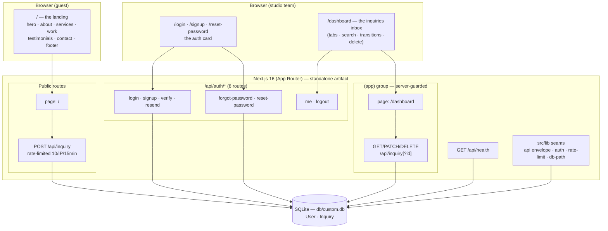

# EleganceFlow — Master Project Architecture Document (PAD) v2.0

**Classification:** Internal Engineering Reference
**Status:** DEFINITIVE, PRODUCTION-LOCKED BLUEPRINT
**Companion Documents:** `README.md` (onboarding) · `AGENTS.md` (agent contract) · `CLAUDE.md` (workflow) · `docs/Tailwind-V4-Validation-Report.md` (styling law)
**Last Updated:** 2026-11-03
**Audience:** Senior Engineers, Tech Leads, DevOps, Onboarding Engineers, and AI Coding Agents
**Rule:** Every architectural decision in this document traces to a specific rationale. Nothing is here "because it's popular."

#### Revision Block — v2.0 (Tracked Changes)

- `[CA]` **The session-199 domain transformation.** The reference re-pointed from the NEO CRM (`neo-crm-8ab2c17c.base44.app`) to **EleganceFlow** (`colossal-elevate-service-flow.base44.app`, a premium creative-studio marketing site). Following the repo's domain-transformation doctrine (the budget-wiser Task-190 precedent): the CRM domain's surfaces retired (16 page families, 11 API route families, ~20 lib modules, the Zustand store, 12 orphan ui primitives, ~90 sweep scripts, 11 dependencies), the infra seams carried verbatim (auth, api envelope, rate-limit, boot-env, db-path, toast), and the app rebuilt byte-mirrored from **nine live Playwright probes** of the new reference. Supersets: persisted inquiries + the authenticated studio inbox at `/dashboard`, the SEO metadata family, the designed 404.

---

## Table of Contents

1. [System Overview & Decisions](#1-system-overview--decisions)
2. [High-Level System Topology](#2-high-level-system-topology)
3. [Application Architecture](#3-application-architecture)
4. [Data Architecture](#4-data-architecture)
5. [Design System Reference](#5-design-system-reference)
6. [Security Architecture](#6-security-architecture)
7. [Testing Strategy](#7-testing-strategy)
8. [Build & Deployment](#8-build--deployment)
9. [Developer Handbook](#9-developer-handbook)
10. [Known Issues & Outstanding Tasks](#10-known-issues--outstanding-tasks)
11. [Key Files Reference](#11-key-files-reference)
12. [Glossary](#12-glossary)

---

## 1. System Overview & Decisions

### 1.1 Document Purpose

This PAD is the single source of truth for the EleganceFlow codebase: what every component is, why every decision was made, and how to extend, debug, or replicate the project. It is written for engineers who will change this code, not for people evaluating it.

### 1.2 Technology Stack Summary

| Layer | Technology | Version | Key Rationale |
| --- | --- | --- | --- |
| Web framework | Next.js (App Router) | ^16.4.2 | Server components guard the authed surface; route handlers serve the API; standalone output is the deployment unit |
| UI runtime | React | ^19.3.1 | The reference's client interactivity class (filters, carousel, form, mobile menu) |
| Language | TypeScript | 5.x (strict) | No `any` in new code; the tsc gate is load-bearing |
| Styling | Tailwind CSS | ^4.3.3 | CSS-first `@theme`; the reference compiles v3-era CSS — every family re-pinned in `globals.css` (see §5) |
| ORM | Prisma | ^6.19.3 | Type-safe queries; `output`-traced schema for the standalone artifact |
| Database | SQLite | via Prisma | Zero-config local story; `db/` at repo root, path-normalized by `src/lib/db-path.ts` |
| Validation | Zod | ^4.6.7 | Every request body parses through one seam (`parseBody`) |
| Auth | node:crypto (scrypt + HMAC) | built-in | Zero auth dependencies; the session + password libs in ~250 lines (routes included, ~830), fully unit-pinned |
| Icons | lucide-react | ^0.525.0 | The reference's exact icon set at its exact sizes |
| Unit tests | Vitest | ^5 | Node env, `@` alias → `src/` |
| E2E tests | Playwright | ^1.64.1 | Boots the standalone artifact; storageState auth; one worker |
| A11y engine | axe-core | ^4.13.0 (devDep) | Injected by the two-gate spec |

### 1.3 Architecture Decision Records

**ADR-001: Next.js App Router with a server-guarded `(app)` route group**

- **Context:** The reference is a base44 SPA: every route serves 200 and its client router walls guests. That posture leaks page HTML to crawlers and lets a client-side guard regress silently.
- **Decision:** Public surfaces (`/`, `/login`, `/signup`, `/reset-password`, the public POST `/api/inquiry`) render without session reads; the workspace (`/dashboard` + the sessioned inquiry family) lives in `src/app/(app)/`, whose `layout.tsx` resolves the session SERVER-side — a guest never receives the inbox's HTML.
- **Rationale:** Fix-over-defect property: the wall can't regress client-side. The guest redirect rides `GuestLoginRedirect` → `/login?from_url=<abs>` (the reference's own round-trip, with the same-origin open-redirect guard).
- **Consequences:** Every inbox route is `force-dynamic` (a session read per request — SQLite local, negligible). 
- **Alternatives rejected:** middleware-based wall (a `headers()` probe carries no path — the from_url round-trip needs it); client-side wall (the reference's own defect).

**ADR-002: The domain transformation (CRM → EleganceFlow)**

- **Context:** The repo's reference re-pointed. The prior 198 sessions built the NEO CRM clone; session-199's audit found a completely different app behind the new URL.
- **Decision:** Retire the CRM domain, carry the infra seams, rebuild the app byte-mirrored from nine live DOM probes. Git history preserves everything retired.
- **Rationale:** The repo's own precedent (budget-wiser Task 190) proved the doctrine; byte-parity requires building from the live reference's DOM, not from memory.
- **Consequences:** The CRM-era tests (~100 files) retired with the domain; the suites rebuilt at 339 unit / 53 e2e, sized to the new codebase. `neo-crm_SKILL.md` stays as the lineage record; `elegance-flow_SKILL.md` carries the new domain.
- **Alternatives rejected:** Keeping CRM pages as dead routes (unmaintained, unpinned, misleading); a second app inside the repo (the doctrine forbids dual-domain trees).

**ADR-003: The inquiry superset (persist, don't just toast)**

- **Context:** The reference's contact form answers a toast and discards the submission (live-verified). A production studio site cannot lose leads.
- **Decision:** The form POSTs `/api/inquiry` — public, Zod-validated through `parseBody`, rate-limited 10/IP/15-min with `Retry-After`, Prisma insert. The success toast is the reference's byte-verified pair. The studio team reads/triages/deletes inquiries at `/dashboard`.
- **Rationale:** The deviation is a strict functional superset, documented at every layer.
- **Consequences:** The status transitions (`new | read | archived`) and the two-step delete are OUR design (the reference has none) — they pass WCAG AA outright and cite no sanctioned matchers.
- **Alternatives rejected:** Toast-only (parity with a defect, not a feature); email delivery (no mail transport in scope; `NEO_DISABLE_IN_APP_OTP`/`_RESET` knobs carry the future mail path).

**ADR-004: Hand-rolled scrypt + HMAC cookie sessions**

- **Context:** Zero-dependency auth, fully unit-pinnable, no opaque provider.
- **Decision:** `src/lib/auth.ts` + `src/lib/password.ts` (node:crypto only): scrypt (N=16384) hashed-at-rest passwords; HMAC-signed `neo_session` cookie embedding `userId` + the row's `tokenVersion`; 7-day fixed expiry (issued at login, no re-issue on read). Email-verification codes stored HASHED; reset tokens stored hashed (SHA-256), consumed atomically (conditional `updateMany`), single-use, 60-min TTL. A password reset bumps `tokenVersion` and evicts every prior cookie.
- **Rationale:** ~160 sessions of production hardening, every seam unit-pinned; no dependency can silently weaken it.
- **Consequences:** No OAuth, no SSO. The Google button on the login card answers an honest "not configured" info toast.
- **Alternatives rejected:** Auth.js (opaque, heavy, untestable at the seam level); JWT (no revocation dimension without a store).

**ADR-005: Tailwind v4 with the v3 palette re-pinned**

- **Context:** The reference compiles v3-era CSS. v4 re-derived its default palette in oklch — every chromatic step diverges visibly (verified against the installed 4.3.3: `zinc-100` v4 oklch(96.7% 0.001 286.375) vs the reference's computed `rgb(244,244,245)`, and so on for every family/step used in `src/`).
- **Decision:** `globals.css` `@theme` re-pins every literal (family, step) pair to the v3 values — zinc (session-199), amber, slate, the s88 family before it — plus `--shadow-sm`, `--blur-sm`, `@custom-variant hover`, and the `leading-*` re-derivations.
- **Rationale:** Parity is computed-face identity; without the re-pins the same class string paints different pixels.
- **Consequences:** New colors must be added to the re-pin block (or verified byte-equal) — the landing battery pins the zinc family.
- **Alternatives rejected:** Tailwind v3 (downgrade); oklch targets (the reference's pixels are the contract).

**ADR-006: Computed-face parity, proven live**

- **Context:** Class-string mirroring is necessary but not sufficient — cascade order differs between the reference's v3 build and our v4 build.
- **Decision:** `scripts/parity-199.ts` boots both apps, extracts ~40 computed-style faces per viewport, and diffs. The one accepted delta: the scrolled header's `bg-zinc-950/95` serializes as `oklab(… /0.95)` (v4 color-mix) vs the reference's `rgba(9,9,11,0.95)` — numerically the same color (`oklabToSrgb(0.140764, 0.00120224, -0.00421676) = (9,9,11)`), the s18 serialization class.
- **Consequences:** The parity script is the acceptance evidence for any styling change to the reference-mirrored surfaces.
- **Alternatives rejected:** Screenshot diffing (fonts/antialiasing noise); manual review (drifts).

---

## 2. High-Level System Topology



Constraints: one Node process (the standalone server); one SQLite file; no external services; the Unsplash imagery and lucide icons are the only third-party fetches (rendering-time).

---

## 3. Application Architecture

### 3.1 The Layer Model

```
Layer 0: prisma/schema.prisma — the data model (User, Inquiry).
         Rule: the Prisma client is the only DB access; every consumer imports src/lib/db.
Layer 1: src/lib — the seams, 16 modules (api, auth, password, rate-limit,
         schemas, db, db-path, site, site-content, page-layout, login-reset,
         verification, verification-server, boot-env, chunk-recovery, utils).
         Rule: pure, unit-testable, no React. Routes compose seams; they never inline seam logic.
Layer 2: src/app/api — route handlers. Rule: envelope in/out (ok/fail), parseBody
         for every body, requireSession for every sessioned route, try/catch → ERR.INTERNAL.
Layer 3: src/components — presentation. Rule: content strings come from
         src/lib/site-content.ts; class strings are the reference's own (byte-mirrored).
Layer 4: src/app pages — thin routes composing Layer 3; metadata via
         src/lib/site.ts's pageMetadata() factory; the (app) group guards server-side.
```

The Golden Rule: **a class string on a reference-mirrored surface is evidence-backed or it doesn't ship** — every pin cites its probe.

### 3.2 Annotated Directory Structure

```
elegance-flow/
├── prisma/
│   ├── schema.prisma          # User (auth surface) + Inquiry (the superset's model)
│   └── seed.ts                # idempotent: 3 inquiries (one per status) + 4 users, upsert-by-email
├── db/                        # gitignored; custom.db (dev) · e2e.db · smoke.db
├── src/
│   ├── app/
│   │   ├── layout.tsx         # root layout: metadataBase + OG family + Toaster
│   │   ├── page.tsx           # the public landing (renders LandingPage)
│   │   ├── globals.css        # @theme tokens — THE v3 re-pins (§5)
│   │   ├── not-found.tsx · not-found-body.tsx   # the designed 404 (true 404 status; our superset)
│   │   ├── error.tsx · global-error.tsx  # error boundaries (chunk-recovery ride)
│   │   ├── login/ · signup/ · reset-password/   # the auth card family
│   │   ├── (app)/
│   │   │   ├── layout.tsx     # the server guard: getSessionUser → AppShell | GuestLoginRedirect
│   │   │   └── dashboard/
│   │   │       ├── page.tsx   # server route: metadata + InboxPage
│   │   │       └── inbox-page.tsx  # the client inbox
│   │   ├── api/
│   │   │   ├── auth/           # login · signup · verify · resend · forgot-password
│   │   │   │                   # reset-password · me · logout (8 handlers)
│   │   │   ├── inquiry/        # POST (public) + GET (sessioned list)
│   │   │   ├── inquiry/[id]/   # PATCH (status) + DELETE (sessioned)
│   │   │   ├── health/         # GET: db round-trip; 503 when down
│   │   │   ├── robots.txt/ · sitemap.xml/ · manifest.json/   # the SEO family
│   │   ├── icon.png · apple-icon.png      # the file-convention icons
│   │   └── vendor/tw-animate.css          # the tw-animate utilities (the toast's enter/exit classes)
│   ├── components/
│   │   ├── landing/landing-page.tsx     # THE reference mirror (the one-pager)
│   │   ├── layout/
│   │   │   ├── login-card.tsx           # the auth card (5 in-place views)
│   │   │   ├── reset-password-screen.tsx# the reset form (token-aware)
│   │   │   ├── app-shell.tsx            # the authed chrome (topbar + main + footer)
│   │   │   └── guest-login-redirect.tsx # the from_url wall shim
│   │   └── ui/toast.tsx                # the toast system (module-level store)
│   ├── lib/                    # see §3.1 Layer 1
│   ├── types/index.ts          # User · Inquiry wire shapes · Result
│   └── instrumentation.ts     # the boot gate (boot-env)
├── tests/                     # 28 *.test.ts + e2e/ (6 specs + setups)
├── scripts/                   # census · smoke ladder · parity probe · captures · probes
├── docs/                      # plans · screenshots · Tailwind report · skills
├── skills/                    # the catalog + 100+ skills (agent tooling)
├── AGENTS.md · CLAUDE.md · README.md · worklog.md · this PAD
└── next.config.ts · tsconfig.json · eslint.config.mjs · vitest.config.ts · playwright.config.ts
```

### 3.3 Critical Code Patterns

**Pattern 1 — The parseBody seam (every body, one door)**

```ts
// src/app/api/inquiry/route.ts (POST) — the canonical route shape
export async function POST(req: Request) {
  // The auth family's canonical order: the limiter, then the composed
  // parse seam (the declared-size pre-gate rides INSIDE parseBody).
  const limit = rateLimit(`inquiry:${clientKey(req)}`, INQUIRY_RATE_LIMIT, INQUIRY_RATE_WINDOW_MS);
  if (!limit.allowed) return ERR.RATE_LIMITED(limit.retryAfterSec);

  const parsed = await parseBody(req, inquiryCreateSchema);
  if (!parsed.ok) return parsed.response;   // the Zod seam's own 400s
  const body = parsed.data;

  try {
    const inquiry = await db.inquiry.create({ data: { ...body, status: "new" } });
    return ok({ id: inquiry.id }, 201);
  } catch {
    return ERR.INTERNAL();                   // DB failures stay inside the envelope
  }
}
```

*Why this pattern:* `parseBody` composes the content-type CSRF gate, the declared-length 16KB pre-gate, and the schema — one call, unit-gated, no bare `req.json()` anywhere in `src/app/api` (the body-pregate suite sweeps every route file).

**Pattern 2 — The content seam (site-content is the ONE source)**

```ts
// src/lib/site-content.ts — the DOM-case discipline
export const HERO = {
  eyebrow: "Premium Services",              // DOM text; "PREMIUM SERVICES" rides CSS uppercase
  headingLines: ["Work that speaks", "for itself."],  // the reference's h1 spans
  primaryCta: "Start a Project",
  ...
} as const;

// src/components/landing/landing-page.tsx — pure presentation
<h1 className="text-5xl md:text-7xl lg:text-8xl font-black text-white tracking-tight mb-8">
  <span className="block">{HERO.headingLines[0]}</span>
  <span className="block">{HERO.headingLines[1]}</span>
</h1>
```

*Why:* e2e locators and unit pins assert against DOM-case strings; the component layer never hand-spells content. `tests/site-content.test.ts` pins every string against the probe record.

**Pattern 3 — The computed-face re-derivation (the s11 doctrine)**

```tsx
{/* The reference's class list carries leading-[0.9], but its OWN build never
    applies it at md+ (its text-Nxl line-height:1 rules sort later). Our v4
    sorts the arbitrary leading LAST at every width — so the port is
    leading-[0.9] md:leading-none: 0.9 below md, 1 from md up. */}
<h1 className="... leading-[0.9] md:leading-none tracking-tight mb-8">
```

*Why:* parity is the COMPUTED face, not the literal class. Copying a class that renders differently than it reads is the one thing the doctrine forbids — and the parity probe would catch it anyway (86.4px vs 96px line-heights).

**Pattern 4 — The two-step delete (destructive actions never ride one click)**

```tsx
{confirmId === row.id ? (
  <>
    <button data-testid="confirm-delete" onClick={() => void remove(row)}>Confirm delete</button>
    <button onClick={() => setConfirmId(null)}>Cancel</button>
  </>
) : (
  <button data-testid="delete" aria-label={`Delete inquiry from ${row.name}`}
          onClick={() => setConfirmId(row.id)}>
    <Trash2 size={14} />
  </button>
)}
```

*Why:* the inbox is OUR surface — there is no reference face to mirror, so the production-grade pattern ships with its own pins (`tests/auth-surfaces.test.ts` + the e2e battery).

---

## 4. Data Architecture

### 4.1 Schema

```prisma
model User {
  id            String   @id @default(cuid())
  email         String   @unique            // normalized lowercase at the Zod seam
  name          String
  passwordHash  String                      // scrypt, auth.ts's format
  avatarColor   String   @default("#2563eb")
  photoUrl      String?
  role          String   @default("user")
  verificationCodeHash  String?             // 6-digit OTP hashed at rest
  verificationAttempts  Int       @default(0)
  verificationExpiresAt DateTime?
  tokenVersion  Int      @default(0)        // the revocation dimension
  resetToken            String?             // SHA-256 hex of the raw token
  resetTokenExpiresAt   DateTime?
  createdAt DateTime @default(now())
  updatedAt DateTime @updatedAt
}

model Inquiry {
  id        String   @id @default(cuid())
  name      String                      // ≤ 120 chars (Zod)
  email     String                      // normalized lowercase, RFC-ish regex
  service   String                      // the form-select vocabulary (5 options)
  message   String                      // ≤ 2000 chars
  status    String   @default("new")    // new | read | archived
  createdAt DateTime @default(now())
  updatedAt DateTime @updatedAt
  @@index([status]) @@index([createdAt])
}
```

### 4.2 Persistence Strategy

- **Path resolution:** `src/lib/db-path.ts` normalizes `file:` URLs to `<repo>/db/<name>` for BOTH the Prisma CLI (relative to `prisma/schema.prisma`) and the running server (CWD-independent). `bun run db:census` prints the resolved path + counts and fails on drift.
- **Migrations:** `db push` (no migration journal — the dev-story contract); the schema is the source of truth.
- **Idempotent seed:** `deleteMany` the domain table, upsert users by email (ids stay stable across re-seeds — session cookies survive).
- **Scratch databases:** `db/e2e.db` (playwright global-setup pushes + seeds per run), `db/smoke.db` (the smoke ladder) — all gitignored.
- **The atomic transitions:** the PATCH status move and the DELETE both ride `updateMany`/`deleteMany` + count — a missing row answers 404, a racing replay can never resurrect.

---

## 5. Design System Reference

### 5.1 Typography

The reference ships **zero webfonts** — the stack is pinned in `@theme` (`--font-sans: ui-sans-serif, system-ui, sans-serif, "Apple Color Emoji", …`). Display headings: `font-black`, `tracking-tight`, two-block-span constructions; body: `text-sm/base/lg` system sizes. The landing ships sharp corners (radius 0) everywhere; the auth card carries `rounded-2xl` + slate.

### 5.2 Color Tokens (the re-pin family)

| Role | Token / class | Hex (v3 re-pin) | Notes |
| --- | --- | --- | --- |
| Dark sections | `bg-zinc-950` | #09090b | rgb(9,9,11) — computed-verified on the reference |
| Service cards | `bg-zinc-900` | #18181b | with `border-white/5`, hover `border-white/20` |
| Micro-labels | `text-zinc-400` | #a1a1aa | the reference's form-label ink (sanctioned at 2.56:1) |
| Body on white | `text-zinc-500` | #71717a | |
| Filter chip inactive | `bg-zinc-100 text-zinc-500` | #f4f4f5 / #71717a | 4.39:1 (axe) — sanctioned (the reference's own face) |
| Accent | `bg-amber-500 text-black` | #f59e0b | every CTA, every eyebrow, the accent bar, the active chip |
| Featured card | `bg-amber-500` + `text-zinc-950`, body `text-zinc-900/70` | — | the Design & Web card (probe-verified) |
| Auth card | slate family (re-pinned) + `bg-white/95 backdrop-blur-sm` | — | `--blur-sm: 4px` re-pin |

**The WCAG 2.2 AA posture:** structural violations zero everywhere; color-contrast nodes on reference-mirrored surfaces must cite the sanctioned register in `tests/e2e/a11y.spec.ts` (each matcher names its probe-verified citation); the superset's own surfaces (inbox, shell) carry no matchers — they pass outright (amber-700 inks, zinc-600/500 muted text, white/50 footer).

### 5.3 Component Primitives

No UI framework beyond Tailwind: the landing is hand-built reference markup; `ui/toast.tsx` is the only shared primitive (a module-level store + viewport, mirroring the reference's toast viewport classes). The 12 shadcn-era primitives retired with their CRM consumers.

### 5.4 Motion

The reference's mount-time reveal animations (inline opacity/translateY) are transients — NOT reproduced (at-rest parity is byte-identical without them; documented at the landing head). The globals' `prefers-reduced-motion` block and `@custom-variant hover` un-wrap (touch hovers fire) are the standing motion contracts; the transition classes on the landing are the reference's own (`transition-all duration-500` header, `duration-700` image scales).

---

## 6. Security Architecture

### 6.1 Security Rules

| Rule | Enforcement |
| --- | --- |
| Every body-parsing route validates size (16KB), content-type (JSON-only), shape (Zod) | `parseBody` seam — unit-gated (body-pregate suite sweeps `src/app/api/**`) |
| Every sessioned route resolves the session server-side | `requireSession()` — the (app) layout guard + every sessioned handler |
| Every public mutating route is rate-limited per IP | `rateLimit` fixed windows; 429 carries `Retry-After` (pinned) |
| Every route answers the envelope | `ok`/`fail`/`ERR.*`; DB writes wrapped → `ERR.INTERNAL()` |
| No user enumeration | signup duplicate 409 vs. forgot-password 200 for known AND unknown emails |
| No open redirect | `resolveFromUrl` same-origin check on `from_url` |
| Secrets never in the tree | `.env` gitignored-by-convention; boot gate fail-fasts a missing `AUTH_SECRET` in production |
| No keys/shims committed | the ssh wrapper reads keys from OUTSIDE the repo (tempfile 0600, shredded after) |

### 6.2 Security Utilities

- `src/lib/password.ts` — scrypt (N=16384, 16B salt) hash/verify + the timing equalizer.
- `src/lib/auth.ts` — HMAC-SHA256 cookie sessions, hashed-at-rest OTP + reset tokens, tokenVersion compare, atomic reset consumption.
- `src/lib/rate-limit.ts` — per-process fixed windows with `clientKey` (XFF last-hop trust via `NEO_PROXY_HOPS`, fail-closed to 1).
- `src/lib/api.ts` — `parseBody` (content-type gate → declared-length fast path → stream counter → Zod), `ERR` family.
- `src/lib/boot-env.ts` — the production boot gate (refuses to serve without a real `AUTH_SECRET`; the log names the fix).

### 6.3 Auth Flows

1. **Login:** rate-limit → Zod → timing-equalized verify → verification-pending 403 → cookie mint (id + tokenVersion).
2. **Signup:** rate-limit → Zod → uniqueness → hashed OTP → (in-app code delivery behind `NEO_DISABLE_IN_APP_OTP`).
3. **Verify:** attempt ladder (5-wrong lockout, atomic increments) → session mint on success.
4. **Forgot/reset:** no-enumeration 200 → hashed single-use 60-min token → conditional atomic consume → `tokenVersion++` (all prior cookies die) → new session.

### 6.4 Threat Model (key vectors)

| Vector | Mitigation |
| --- | --- |
| Password stuffing | 10/IP/15-min + scrypt cost + the timing equalizer (registered-email probing) |
| CSRF on state-changing routes | JSON-only content-type gate (the `enctype="text/plain"` form family) + same-site=lax cookies |
| Oversized bodies | 16KB declared pre-gate + streamed counter (before any parse) |
| Stolen session persistence | tokenVersion revocation on reset; 7-day expiry |
| Reset token replay | conditional atomic consume + 60-min TTL + hashed at rest |
| Open redirect via `from_url` | same-origin resolution, `/dashboard` fallback |

---

## 7. Testing Strategy

### 7.1 Distribution

| Category | Files | Checks | Location | Framework |
| --- | --- | --- | --- | --- |
| Unit — seam batteries | 13 | 196 | `tests/*.test.ts` | Vitest (node, imports the seams) |
| Unit — source contracts | 15 | 171 | `tests/*.test.ts` | Vitest (module contracts + comment-stripped reads) |
| E2E | 6 specs | 54 | `tests/e2e/*.spec.ts` | Playwright (standalone artifact, 1 worker) |
| Smoke | 1 ladder | 14 rungs | `scripts/smoke-test.sh` | curl + the artifact on :3210 |
| Live parity | 1 probe | ~80 faces | `scripts/parity-199.ts` | Playwright (both apps) |
| A11y | 6 scans | 2 gates | `tests/e2e/a11y.spec.ts` | axe-core 4.13 |

### 7.2 Patterns

- **Source-contract pins** read comment-stripped sources: a literal pinned by a record comment alone is a vacuous pin; absence pins never fail on the retired form quoted in its own documentation (the s64/s65/s66 needle-in-own-docs lesson).
- **The e2e self-sufficiency contract:** one worker, alphabetical file order — every spec drives its OWN probe row (public POST on an isolated `x-forwarded-for` bucket), never another spec's rows.
- **The a11y two-gate:** structural zero; contrast nodes on mirrored surfaces cite sanctioned matchers (probe-verified citations).
- **The smoke ladder** validates the STANDALONE artifact (not the dev server): health, walls, SSR faces, login round-trip, Zod 400, public inquiry 201, logout teardown, 429 exhaustion, SEO family, secretless-boot refusal, artifact hygiene (no .env/.git/db/skills/docs inside the artifact).

### 7.3 Pre-Push Checklist

```
bun run lint        # 0/0 (--max-warnings 0)
bun run typecheck   # 0 errors
bun run test        # 367/367
bun run build       # 22 routes, standalone artifact
./scripts/smoke-test.sh   # 14/14
CI=1 bun run test:e2e     # 54/54
bun scripts/parity-199.ts # COMPUTE IDENTICAL (dev server on :3000)
```

The `gate` script chains the first six. No hosted CI exists — the local gate is the only gate.

---

## 8. Build & Deployment

### 8.1 Production Build

`bun run build` → `output: "standalone"`: `.next/standalone/server.js` + the traced `prisma/schema.prisma` (at a stable path for the db-path resolver) + the copied `public/` and `.next/static`. Artifact hygiene is smoke-gated (14): no `.env`, `.git`, `db/`, `skills/`, `docs/`, logs inside the artifact.

### 8.2 Environment Variables

| Name | Req/Opt | Description | Default |
| --- | --- | --- | --- |
| `DATABASE_URL` | required | SQLite `file:` URL; relative resolves against `prisma/schema.prisma` (CLI) — `file:../db/custom.db` = repo-root `db/`. Absolute recommended in production | — |
| `AUTH_SECRET` | required (prod) | HMAC session secret, ≥16 chars; a missing/short value FAILS THE BOOT in production | insecure dev constant |
| `NEXT_PUBLIC_SITE_URL` | build-time | Canonical origin (metadataBase, OG/Twitter, sitemap, robots, manifest) | `http://localhost:3000` |
| `NEO_PROXY_HOPS` | optional | Trusted XFF hops for the rate-limit IP key (unparsable → fail-closed to 1) | unset → 1 |
| `NEO_DISABLE_IN_APP_OTP` / `_RESET` | optional | `"1"` stops responses carrying the demo OTP code / reset link (a mail transport owns delivery) | unset → in-app delivery |

### 8.3 CI/CD

None hosted (no `.github/workflows`). The local `gate` chain IS the pipeline; pushes ride `docs/ssh_git_wrapper_v3.py` (SSH, main-only, remote-ref verified). See `docs/DEPLOYMENT.md` for the full runbook.

---

## 9. Developer Handbook

### 9.1 Local Setup

```bash
bun install && bun run db:push && bun run db:seed && bun run db:census
# expect: pristine: MATCH (3 + 4 users — the seed contract)
bun run dev
```

### 9.2 Common Commands

See `AGENTS.md` (the command table is the agent-facing copy); the `gate` script is the canonical chain.

### 9.3 Code Style

Enforced: `eslint --max-warnings 0` (flat config, strict TS rules), `tsc --noEmit`. Conventions: content strings via `site-content.ts`; class strings byte-mirrored (comment the probe at non-obvious sites); envelope-only API responses; `data-testid` on inbox controls (the e2e surface).

### 9.4 Git Workflow

`main` only (no feature branches — the operator contract). Conventional Commits. The SSH wrapper handles the push (key never inside the repo; paramiko shim in OpenSSH-less sandboxes per `docs/how-to-git-push-using-ssh-wrapper_SKILL.md`).

---

## 10. Known Issues & Outstanding Tasks

| Priority | Issue | Impact | Status |
| --- | --- | --- | --- |
| LOW | Dependency advisories: `bun audit` reports 10 (4 high, 5 moderate, 1 low) — ALL dev/build/lint/test toolchain-transitive (minimatch via eslint · deepmerge-ts via the prisma CLI's @prisma/config · vite + launch-editor via vitest · source-map-js via postcss — build-time · zod@4.6.5 NESTED inside eslint-config-next›eslint-plugin-react-hooks) | Zero runtime request-path exposure: the runtime direct zod is 4.6.7 (above the GHSA-mrhx-c7xc-m3w5 patched floor 4.6.6), and the parseBody 16KB pre-gate bounds the oversized-collection class regardless. Advisory-DB entries post-date the round-4 "zero vulnerabilities" line — the standing-duty re-triage is the family pattern | Accepted + ledger-pinned (round 5): lockfile untouched per the surgical-change doctrine (no security driver); the patch-level devDep drift (tailwindcss 4.3.4 · vitest 5.1.0 · eslint-config-next 16.4.4) recorded informational. Re-triage on the standing cadence; any advisory that reaches a runtime dep is the security driver that reopens the lockfile |
| LOW | The login card's Google button is a stub (info toast) | No OAuth sign-in | Documented behavior (no provider configured) |
| LOW | The reference's mount-time reveal animations are not reproduced | Visual (transient) difference on first paint | Deliberate, documented (at-rest parity holds) |
| LOW | Mail delivery for OTP/reset is in-app only (demo mode) | Production needs a mail transport + the `NEO_DISABLE_*` knobs | Knobs shipped; transport out of scope |
| LOW | The `styles` for the designed 404 carry `focus:outline-none` (v4 genus) | Keyboard focus face on the 404's home button | The reference's own 404 ships none; ours is a superset surface — acceptable, documented |
| CLOSED | The sitemap shipped the retired CRM route list for one cycle (the post-ship audit catch — 10 of its 11 locs were 404s) | SEO: crawlers fetched dead URLs; the superset's own surface lied about the app | Closed in-round: re-derived to the public surface (landing + the auth family); the census battery `tests/sitemap-routes.test.ts` now pins the list to the live `src/app` census |

No CRITICAL or HIGH issues are open. The gate (367 unit / 54 e2e / 14 smoke / parity probe) is green at ship and re-proven at the post-ship audit close, the round-4 fresh-context re-audit, the round-5 re-validation (the DEPLOYMENT.md doc cure + the advisory re-triage), the round-6 re-validation (the deployment-doc census pin — DEPLOYMENT.md's claims now census-pinned by `tests/deployment-doc-census.test.ts`, closing the unpinned-doc class that let both stragglers ship), the round-7 re-validation (the root-docs count-ladder census pin — `tests/count-ladder-census.test.ts` pins the five root docs' ladder claims to the live tree census, closing the class at the root level after three stale sites drifted through four re-anchors), and the round-8 re-validation (the six v4 re-pin traps' token family unit-pinned by `tests/re-pin-tokens.test.ts` + the doc-pointer census — `tests/doc-pointer-census.test.ts` pins every load-bearing doc's file references to the live tree, closing the dangling-pointer class that shipped the lineage spec citations).

---

## 11. Key Files Reference

| File | ~Lines | Purpose |
| --- | --- | --- |
| `src/components/landing/landing-page.tsx` | 659 | THE reference mirror — the whole public surface |
| `src/lib/site-content.ts` | 324 | Every reference string/class (the one source, unit-pinned) |
| `src/app/globals.css` | 468 | The @theme tokens — the six re-pin families |
| `src/lib/api.ts` | 308 | The envelope + parseBody seam |
| `src/lib/auth.ts` | 184 | scrypt + HMAC sessions, the full auth funnel |
| `src/lib/schemas.ts` | 157 | The Zod families (auth carried + inquiry) |
| `src/app/(app)/dashboard/inbox-page.tsx` | 368 | The superset inbox (the authed surface) |
| `src/components/layout/login-card.tsx` | 813 | The auth card (5 in-place views) |
| `prisma/schema.prisma` | 77 | User + Inquiry |
| `scripts/parity-199.ts` | 155 | The live computed-style parity probe |
| `scripts/smoke-test.sh` | 167 | The 14-rung artifact ladder |
| `tests/e2e/mobile-navigation.spec.ts` | 100 | The operator's standing emphasis (the 390 menu battery) |
| `tests/e2e/a11y.spec.ts` | 175 | The two-gate + the sanctioned register |
| `docs/plans/2026-11-03-session199-eleganceflow-domain-transformation.md` | 306 | THIS transformation's plan (the probe record) |

---

## 12. Glossary

| Term | Meaning |
| --- | --- |
| **The reference** | `colossal-elevate-service-flow.base44.app` — EleganceFlow, the base44 creative-studio site this repo clones |
| **The superset** | The documented functional additions: persisted inquiries, the `/dashboard` inbox, the SEO family, the designed 404, deep-linkable `/signup` |
| **Inquiry** | A landing contact-form row (name, email, service, message; status `new`/`read`/`archived`) |
| **The studio team** | The authenticated users (the seeded demo accounts) |
| **Domain transformation** | The doctrine: on a reference re-point, the old domain's surfaces retire, the infra seams carry verbatim, the app rebuilds byte-mirrored from the new reference |
| **Re-pin** | A v3 palette/token value pinned into `@theme` because v4's default re-derivation diverges |
| **Computed-face parity** | The acceptance bar: `getComputedStyle` values must match the live reference (class literals are means, not the contract) |
| **Serialization class (s18)** | Identical paints whose computed-value STRING forms differ (`oklab(...)` vs `rgba(...)`) |
| **Sanctioned register** | The a11y spec's matcher list: rule → target fragments → probe-verified citation (the reference's own byte-parity palette) |
| **The gate** | `lint → typecheck → test → build → smoke → e2e` (the local pipeline; no CI exists) |
