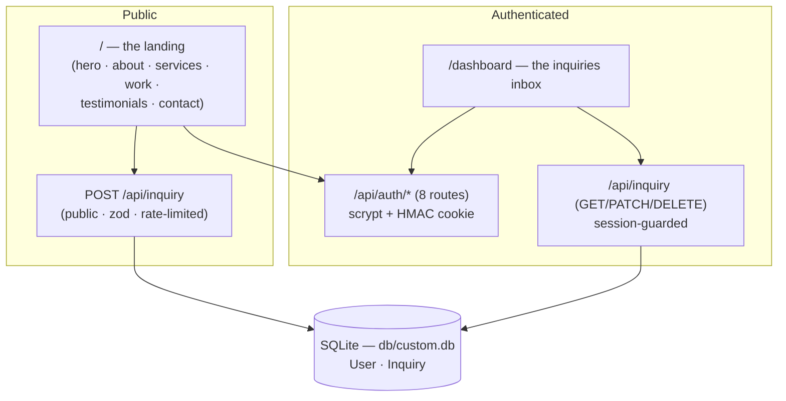

# EleganceFlow

     

A production-grade clone of [the EleganceFlow reference site](https://colossal-elevate-service-flow.base44.app/) — a premium creative-studio marketing site — built as a single Next.js 16 application, plus a **functional superset**: the reference's contact form swaps to an in-place success panel without persisting anything (round-19's live ride); EleganceFlow mirrors that panel AND persists every inquiry and gives the studio team a real inbox behind the login.

**Visual parity is proven, not claimed:** every class string, text node, and icon size on the public landing was extracted from the live reference's DOM by nine Playwright probes, and a computed-style parity probe diffs both apps at desktop (1280) and phone (390) width — every probed face computes identical.

## Key features

| Feature | What it does |
| --- | --- |
| 🖤 One-page landing | The reference's full marketing surface: fixed header with scroll-state flip, zinc-950 hero with the amber accent bar, about with stats, services (featured amber card), portfolio with live filters, testimonial carousel, contact form, footer |
| 📱 Mobile menu | The reference's inline disclosure panel — opens/closes, every link navigates and closes; e2e-pinned at 390×844 |
| 📥 Inquiry inbox (superset) | Every contact-form submission persists; the authenticated `/dashboard` lists, searches, and triages (mark read / archive / unarchive / two-step delete) |
| 🔐 Email + password auth | Hand-rolled scrypt + HMAC cookie sessions, email-verification funnel, hashed single-use password-reset funnel, session revocation via `tokenVersion` |
| 🛡️ Hardened API | Zod validation at every body-parsing seam, per-IP rate limits with `Retry-After`, CSRF content-type gate, bounded body reads, honest `{ ok, error }` envelopes |
| ♿ WCAG 2.2 AA | Structural axe violations zero; every interactive control renders a visible focus ring (keyboard-operability e2e battery); reference-byte-parity colors cite a sanctioned register; the superset's own surfaces pass AA outright |
| 🧪 Full test pyramid | 609 unit checks (54 files), 123 e2e checks (8 specs), a 14-rung smoke ladder against the production artifact, and the live parity probe |

## Quick start

Requires **Node.js ≥20** and **Bun ≥1.1** (or npm — scripts are plain).

```bash
git clone https://github.com/nordeim/elegance-flow.git
cd elegance-flow
bun install

# No .env is needed for local dev — the db-path seam defaults to the repo
# contract db/custom.db (.env is git-ignored, never committed; copy
# .env.example to customize):
bun run db:push      # create the schema
bun run db:seed      # demo data (3 inquiries + 4 users)
bun run db:census    # expect "pristine: MATCH (3 + 4 users — the seed contract)"

bun run dev          # http://localhost:3000
```

**Verify:** the landing renders "Work that speaks for itself."; log in at
`/login` with `sepnetflix2023@outlook.com` / `$Abcd1234` → the inquiries
inbox.

### The full gate

```bash
bun run gate   # lint → typecheck → test (609) → build → smoke (14) → e2e (123)
```

## Architecture

| Layer | Technology | Version | Purpose |
| --- | --- | --- | --- |
| Framework | Next.js (App Router) | ^16.4 | Server components, route handlers, standalone output |
| UI | React | ^19.3 | Client surfaces (landing interactions, inbox) |
| Language | TypeScript | 5.x strict | Type safety end-to-end |
| Styling | Tailwind CSS | ^4.3 | CSS-first `@theme`; the reference's v3 palette re-pinned |
| Database | Prisma + SQLite | ^6.19 | Zero-config persistence (`db/custom.db` at repo root) |
| Validation | Zod | ^4 | Every request body |
| E2E | Playwright | ^1.64 | The standalone artifact, one worker, storageState auth |
| Unit | Vitest | ^5 | Pure seams + source-contract pins |
| Icons | lucide-react | ^0.525 | The reference's exact icon set and sizes |



## File hierarchy (the short tour)

```
elegance-flow/
├── 📂 src/app/
│   ├── 📄 page.tsx                    # the public landing route
│   ├── 📂 (app)/dashboard/            # the authenticated inbox (server-guarded group)
│   ├── 📄 login/ · signup/ · reset-password/   # the auth routes (login/signup: the login card · reset: the platform family)
│   ├── 📂 api/                        # auth (8) · inquiry (2) · health
│   └── 📄 globals.css                 # the @theme tokens (the v3 re-pins)
├── 📂 src/components/
│   ├── 📄 landing/landing-page.tsx    # the reference-mirrored one-pager
│   ├── 📄 layout/                     # login-card · app-shell · reset screen
│   └── 📄 ui/toast.tsx               # the reference's toast system
├── 📂 src/lib/
│   ├── 📄 site-content.ts             # every reference string (unit-pinned)
│   ├── 📄 schemas.ts                  # the Zod families
│   ├── 📄 auth.ts · password.ts       # scrypt + HMAC sessions
│   ├── 📄 api.ts                      # the envelope + parseBody seam
│   └── 📄 db-path.ts                  # the repo-root db resolution
├── 📂 prisma/                         # schema (User · Inquiry) + seed
├── 📂 tests/                          # 54 unit files + e2e/ (8 specs)
├── 📂 scripts/                        # smoke ladder · parity probe · captures
└── 📂 docs/                           # plans · screenshots · skills · the Tailwind v4 report
```

## Environment variables

```bash
DATABASE_URL="file:../db/custom.db"    # SQLite; relative to prisma/schema.prisma (CLI) — db/ at repo root, gitignored
AUTH_SECRET="<openssl rand -hex 32>"   # required in production (≥16 chars; the boot gate refuses without it)
NEXT_PUBLIC_SITE_URL="http://localhost:3000"  # canonical origin; INLINED AT BUILD TIME
```

## Testing

```bash
bun run test                     # 609 checks — pure seams + source contracts
bun run test:e2e                 # 123 checks — standalone artifact, seeded db/e2e.db
./scripts/smoke-test.sh          # 14 rungs — artifact on :3210 with db/smoke.db
bun scripts/parity-199.ts        # live parity vs the reference (dev server on :3000)
```

E2E quirks: the suite boots the **standalone production artifact** (build
first); logins ride ONE shared storageState (the auth endpoints are
rate-limited 10/IP/15-min); repeated local runs may need `CI=1` or a
15-minute window.

## Deployment

`bun run build` emits a self-contained standalone server
(`output: "standalone"`):

```bash
bun run build
cd .next/standalone && node server.js   # PORT + NODE_ENV=production + AUTH_SECRET required
```

See `docs/DEPLOYMENT.md` for the full runbook (env, absolute db path,
the boot gate, artifact hygiene). No Docker config ships — the standalone
artifact is the deployment unit.

## Documentation

- `AGENTS.md` — the agent onboarding file (commands, gotchas, contracts)
- `CLAUDE.md` — the working conventions (the six-phase workflow, parity doctrine)
- `Project_Architecture_Document.md` — the full architecture reference (ADRs, security, testing)
- `docs/Tailwind-V4-Validation-Report.md` — the v4 trap catalog (required reading before styling)
- `docs/plans/` — the session implementation plans
- `worklog.md` — the per-task log

## License

MIT — see `LICENSE`.
